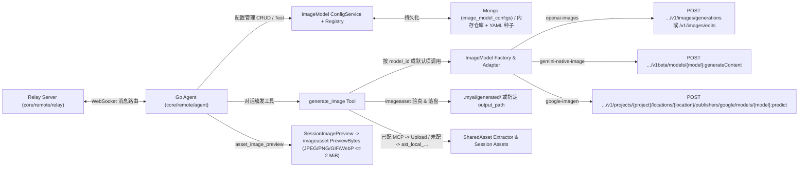

# Go 后端多模型生图、四格式预览与配置管理实现方案

> 本文为 **Go 后端独立实施方案**（覆盖 `core/`、`config/`、`skills/`），定义多协议生图引擎（`openai-images` / `gemini-native-image` / `google-imagen`）、统一本地工具 `generate_image`、YAML + Mongo/内存双模配置管理、四格式（JPEG / PNG / GIF / WebP）透明与动图预览解码、Relay WebSocket 契约以及内置 Skill 对齐。配套移动端实现见 [移动端生图配置、四格式预览与图片持久化方案](FEATURE_MOBILE_IMAGE_GENERATION_AND_CACHE_PLAN.md)。

---

## 1. 背景与后端现状诊断

通过对 `core/`、`config/`、`skills/` 进行源码排查，当前后端在“生图与图像输出”链路存在以下结构性缺口：

| 模块 | 现状与代码定位 | 具体缺口 |
| :--- | :--- | :--- |
| **本地生图工具** | `core/App.go` (`InitRegister`) | 共注册 14 个本地工具，无文生图/图生图工具；未接入 `/v1/images/generations`、`/v1/images/edits`、Gemini 原生出图或 Imagen 接口。 |
| **模型与 URL 配置** | `config/application.example.yaml`、`core/domain/model/protocol.go`、`core/application/model/service/` | 仅管理 5 种纯文本对话模型协议，没有独立的生图模型目录、独立 `base_url`、认证头类型及专属 `api_key` 存储。 |
| **对话模型原生出图** | `core/adapter/model/langchaingo/gemini_response.go` | 响应解析仅允许 `functionCall` 与 `text`，遇到模型返回的 `inlineData` 图片块直接报错 `Gemini returned an unsupported content part`。 |
| **预览解码与压缩** | `core/imageasset/image.go`、`core/remote/protocol/asset_image_preview.go` | 硬编码仅支持 `jpeg`/`png`（源图 `10 MiB`，预览 `256 KiB`、`1024px`），且 `resizePreview` 会把透明 PNG 强行合成到纯白底后转码为静态 JPEG；完全拒绝 GIF 动图与 WebP。 |
| **无 MCP 兜底** | `core/tool/local/attach_image.go`、`core/service/session_image.go` | 未配置外部 `short_links.mcp_url` 时直接报错 `MCP files service is not configured`，工作区产出图片无法向手机端提供私有预览。 |
| **内置 Skill 与子代理断链** | `skills/poster/SKILL.md`、`skills/学术论文写作技能包/paper-figures/paper-figures.md`、`core/domain/subagent/builtin.go` | 海报 Skill 要求调用不存在的 `show_widget`；论文配图 Skill “模式 C” 依赖内置 AI 生图能力；`implementer` 子代理未分配生图工具。 |

---

## 2. 后端整体架构与数据流



核心设计边界：
1. **API Key 严格不出 Go 进程**：密钥仅存于配置持久层、YAML 与内存 `ImageModelRegistry`，不下发给前端或大模型上下文，外链下载生图结果时不附带认证头。
2. **统一 `generate_image` 单工具收敛**：主模型无需区分不同厂商接口差异，传入 `reference_images` 时自动切换到垫图编辑通路。
3. **无外部短链 MCP 亦可预览**：支持与已有 `short_links` MCP 无缝集成，同时也支持本地会话绑定的 `ast_local_<uuid>` 安全读取兜底。

---

## 3. 图像解码与四格式预览底座（`core/imageasset` & `session_image`）

### 3.1 扩展 `core/imageasset/`（修改 `image.go`，新增 `webp.go`）

1. **输入预算与安全限制**：
   - `MaxSourceBytes` 提升至 `16 * 1024 * 1024`（`16 MiB`）；单边最大 `16384`，单帧总像素上限 `16 MP`（`16 * 1024 * 1024`）；多帧 GIF 累计解码像素预算设上限（例如 `<= 128 MP`），防止恶意高帧数炸弹打爆内存。
2. **新增格式探测结构 `Inspect(data []byte) (Info, error)`**：
   - 返回 `{ MIMEType, Width, Height, HasAlpha, IsAnimated, FrameCount }`。
   - **JPEG / PNG**：通过标准库 `image/jpeg` 与 `image/png` 解码头部及色深/色彩类型（识别 PNG RGBA/GrayAlpha 色彩类型及 `tRNS` 透明块标记 `HasAlpha`）。
   - **GIF**：调用 `image/gif.DecodeConfig`；当为动图场景或需编码时通过 `gif.DecodeAll` 读取帧数与帧间延迟，仅一帧且全不透明视为静态图，多帧标注 `IsAnimated = true`。
   - **WebP（`core/imageasset/webp.go`，纯 Go 零 CGO 依赖）**：解析 RIFF 容器及 `VP8 `（有损）、`VP8L`（无损，含 Alpha bit）、`VP8X`（扩展头：读取 Canvas Width/Height、Alpha 标志位 `0x10`、Animation 标志位 `0x02`）与 `ANIM`/`ANMF` 块统计帧数并校对总像素上限。
3. **智能预览分流 `PreviewBytes(ctx context.Context, data []byte) ([]byte, string, int, int, error)`**：
   - 预览输出体积上限提升至 **`2 * 1024 * 1024`（`2 MiB`）**，最大边长 `PreviewMaxEdge = 2048`：
     - **动态 GIF / 动态 WebP（`IsAnimated == true`）**：若原图字节 `<= 2 MiB` 且宽高 `<= 2048`，**零损原字节透传**；若动态 GIF 超出 `2 MiB` 或超过 `2048px`，逐帧等比缩放（保留各帧 `Delay`、`LoopCount` 与 `Disposal` 透明索引）重新编码 GIF 尝试压入 `2 MiB` 内；不可直传的超大动态 WebP 则返回超限提示引导通过原文件/短链查看。
     - **含透明通道的静态 PNG / 静态 WebP（`HasAlpha == true`）**：若原图 `<= 2 MiB` 且宽高 `<= 2048`，**原字节透传保留完整透明通道**；超尺寸静态 PNG 使用**预乘 Alpha 均值缩放**重新编码为 `image/png`（彻底移除把透明像素涂白的旧逻辑）。
     - **不透明静态大图**：继续缩放到 `<= 1024px` 边长并用高质量 JPEG（`82 / 70 / 55` 阶梯）压缩至 `<= 2 MiB`（兼顾移动端大图清晰度与加载速度）。
4. **同步扩充 `core/tool/local/attach_image.go`**：
   - 使用 `imageasset.Inspect` 替代只允许 `jpeg`/`png` 的旧 `Decode`，使工作区产出的 **JPEG / PNG / GIF / WebP** 均可私有挂载回显（Tool Description 同步更新说明）。

### 3.2 本地无 MCP 会话预览兜底（`core/service/session_image.go` & `core/composition/chat/session_assets.go`）

- 当 `SessionImagePreview(ctx, sessionID, assetID)` 查询到的 `AssetRecord` 使用本地占位 ID（`ast_local_` 前缀）或 `s.dependencies.AssetFiles == nil` 时：
  1. 校验该 `AssetRecord` 确属当前 `sessionID` 且未删除；
  2. 通过 `os.OpenRoot` 安全打开会话对应 `WorkspaceRoot` 下的 `AssetRecord.LocalPath`（复用反符号链接穿越校验），校验文件大小 `<= 16 MiB` 并比对 `SHA256(data) == asset.Checksum`；
  3. 调用 `imageasset.PreviewBytes(ctx, data)` 返回自适应格式的预览字节与真实宽高。

---

## 4. 多协议生图引擎与统一本地工具 `generate_image`

### 4.1 领域模型与生成器端口

新增 `core/domain/imagemodel/` 与 `core/port/imagemodel/`：

```go
// core/domain/imagemodel/config.go
package imagemodel

import "time"

type Protocol string

const (
	ProtocolOpenAIImages      Protocol = "openai-images"
	ProtocolGeminiNativeImage Protocol = "gemini-native-image"
	ProtocolGoogleImagen      Protocol = "google-imagen"
)

type AuthType string

const (
	AuthTypeBearer       AuthType = "bearer"
	AuthTypeGoogleAPIKey AuthType = "x-goog-api-key"
	AuthTypeGoogleADC    AuthType = "google-adc" // Vertex AI Application Default Credentials
	AuthTypeNone         AuthType = "none"
)

type Config struct {
	ID        string
	Name      string
	Provider  string
	Protocol  Protocol
	AuthType  AuthType
	BaseURL   string
	APIKey    string
	ModelName string
	Enabled   bool
	IsDefault bool
	CreatedAt time.Time
	UpdatedAt time.Time
}
```

端口契约（`core/port/imagemodel/generator.go`）：

```go
type ReferenceImage struct {
	Data     []byte
	MIMEType string
	FileName string
}

type GenerateRequest struct {
	Prompt          string
	ReferenceImages []ReferenceImage
	Mask            *ReferenceImage
	Size            string // 例如 "1024x1024", "1536x1024", "1024x1536", "auto"
	AspectRatio     string // 例如 "1:1", "16:9", "9:16", "3:4", "4:3"
	Background      string // "auto" | "transparent" | "opaque"
	Quality         string // "auto" | "low" | "medium" | "high"
	OutputFormat    string // "png" | "jpeg" | "webp" | "gif"
}

type GenerateResult struct {
	Data        []byte
	MIMEType    string
	RevisedText string
}

type ImageGeneratorPort interface {
	Generate(ctx context.Context, req GenerateRequest) (GenerateResult, error)
	SupportsReferenceImages() bool
}
```

### 4.2 三大协议适配器（`core/adapter/imagemodel/`）

所有适配器统一创建独立 HTTP 客户端（默认超时 `180s`，禁用自动把凭证带给重定向域名），返回脱敏错误信息：

1. **`openai_images.go`（协议：`openai-images`）**：
   - `SupportsReferenceImages() == true`。
   - **URL 归一化**：`BaseURL` 为空默认 `https://api.openai.com`；自动去掉末尾 `/` 与末尾 `/v1`，避免配置成 `https://host/v1` 时拼出 `/v1/v1/...`。
   - **路由切换**：
     - 无参考图且无蒙版 -> `POST {root}/v1/images/generations`（JSON 提交 `model`、`prompt` 以及显式指定的非 `auto` 字段 `size`/`quality`/`background`/`output_format`）；
     - 有参考图或蒙版 -> `POST {root}/v1/images/edits`（`multipart/form-data`，按顺序写入图片分片并标注真实 MIME，支持多图与可选 `mask`）。
   - **响应与安全下载**：优先解析 `data[0].b64_json`；若上游返回 `data[0].url`，校对为 `http`/`https` 后通过**不附带 `Authorization` 头的裸 HTTP GET** 下载（最大限制 `16 MiB`，与 `MaxSourceBytes` 一致）。
2. **`gemini_native.go`（协议：`gemini-native-image`）**：
   - `SupportsReferenceImages() == true`。
   - **URL 归一化**：`BaseURL` 为空默认 `https://generativelanguage.googleapis.com`；支持自定义任意代理根地址，自动处理是否已含 `/v1beta`。
   - **报文构造**：`POST {root}/v1beta/models/{model}:generateContent`；将全部 `ReferenceImages`（以及可选 `Mask`）编码为 `inlineData` `{ mimeType, data }` 放入 `contents[0].parts`，随后追加文本 `{ text: req.Prompt }`；`generationConfig` 设置 `responseModalities: ["TEXT", "IMAGE"]`，并在指定比例或尺寸时写入 `imageConfig.aspectRatio`。
   - **鉴权与解析**：Gemini Native 默认写 `x-goog-api-key: <APIKey>`，切换为 `bearer` 时写 `Authorization: Bearer <APIKey>`；从 `candidates[0].content.parts` 兼容读取 `inlineData` / `inline_data` 与附带文本。
3. **`google_imagen.go`（协议：`google-imagen`）**：
   - `SupportsReferenceImages() == false`。
   - **报文构造**：`POST {vertex-resource-root}/publishers/google/models/{model}:predict`（`base_url` 必须含 `/v1/projects/{project}/locations/{location}`）；若调用时带了 `ReferenceImages` 或 `Mask`，直接返回可读错误提示改用 `openai-images` 或 `gemini-native-image`。
   - 鉴权支持 `auth_type: google-adc`（自动刷新运行身份凭据，推荐）或显式短期 `bearer` token。
   - 提交 `{ instances: [{ prompt }], parameters: { sampleCount: 1, aspectRatio, outputOptions: { mimeType } }`，解析 `predictions[0].bytesBase64Encoded` 与 `mimeType`。

### 4.3 统一本地工具 `generate_image`（`core/tool/local/generate_image.go`）

1. **工具注册与动态提示**：
   - 在 `core/App.go` (`InitRegister`) 注册；依赖 `ImageModelRegistry`、`files.Service`、`SessionAssetLookup` 与 `HistoryStoreFactory`。
   - `Description()` 动态枚举当前所有 `Enabled == true` 的生图模型：`ID`、`Name`、`Protocol`、是否支持垫图及 `[default]` 标记，便于主模型在用户指定具体模型时正确传 `model_id`。
2. **输入 Schema**：
   - `prompt` (`string`, 必填)：生图/改图描述。
   - `model_id` (`string`, 可选)：指定生图模型 ID，省略使用默认启用模型。
   - `reference_images` (`string[]`, 可选, 最多 4 项)：支持工作区相对路径或会话资源 ID（`"ast_..."` / `"asset:ast_..."`）。
   - `mask_image` (`string`, 可选)：工作区路径或会话 `asset_id`。
   - `output_path` (`string`, 可选)：保存路径；留空自动存入 `.myai/generated/img_<YYYYMMDD_HHMMSS>_<随机hex>.<ext>`（后缀按上游实际返回图像格式匹配）。
   - `size`、`aspect_ratio`、`background` (`auto|transparent|opaque`)、`quality` (`auto|low|medium|high`)、`output_format` (`png|jpeg|webp|gif`)。
3. **权限策略与安全边界**：
   - 权限：`tooldef.PermissionWrite`，`RequiresExplicitApproval() == false`。
   - **升级 `core/application/tool/service/approval_policy.go`**（`requiresExplicitApproval`）：除现有的单字符串路径字段外，扩展检查 `output_path`、`mask_image` 以及 `reference_images` 数组每一项，命中 `pathpolicy.IsProtected` 或工作区外路径时强制拉起人工审批。
   - **读取隔离**：工作区参考图走 `os.OpenRoot` + `os.SameFile` 且必须通过 `imageasset.Inspect` 校验确为完整图片；会话 `asset_id` 必须通过当前 `SessionAssetLookup` 验证属于当前 `sessionID` 且字节通过 `imageasset.Inspect` 验真；落盘写工作区同样经受保护路径检查并调用 `HistoryStore` 备份覆盖前快照。
4. **一步完成落盘与会话资产登记**：
   - 经 `imageasset.Inspect` 检验通过后写工作区文件，计算 `SHA256`。
   - 优先调用 `files.Service.Upload` 上传获取标准 `ast_...`；当未配置外部 MCP 服务时，创建本地 ID `ast_local_<uuid>` 并记录 `LocalPath` 与 `Checksum`。
   - 构造并挂载 `ToolOutput.SharedAsset`，返回给模型的 JSON 包含 `{ asset_id, path, file_name, content_type, width, height, size, model_id, markdown_embed: "" }`。
   - 在 `core/port/repository/asset_record.go` 新增 `AssetSourceGenerateImage = "generate_image"` 并纳入 `IsSessionAttachment()`；同步更新 `core/adapter/persistence/mongo/repository/store.go` 的 `FindSessionAttachment` 查询过滤以及内存模式附件查表逻辑。

---

## 5. 全链路配置管理（YAML 种子 + 双模持久化 + 服务安全约束）

### 5.1 YAML 配置拓展
在 `core/config/properties.go`、`loader.go`、`mapper.go`、`config/application.example.yaml` 新增 `image_generation.models` 列表配置（支持 `${ENV_VAR}` 占位符展开，默认模板注释示例且 `api_key` 置空 `""`）：

```yaml
image_generation:
  models:
    # - id: "gpt-image-proxy"
    #   name: "GPT-Image"
    #   provider: "openai-compatible"
    #   protocol: "openai-images"      # openai-images | gemini-native-image | google-imagen
    #   auth_type: "bearer"            # bearer | x-goog-api-key | google-adc | none
    #   base_url: "https://example.invalid"
    #   api_key: ""
    #   model: "gpt-image-1"
    #   is_default: true
```

### 5.2 Mongo + 内存双模持久层 & 安全规则
- **持久层**：
  - Mongo：在 `core/adapter/persistence/mongo/repository/` 新增 `image_model_configs` 集合操作（`SaveImageModelConfig`、`GetImageModelConfig`、`ListImageModelConfigs`、`DeleteImageModelConfig`）。
  - 纯内存回退：当 `app.mongoDb == nil` 时初始化内存实现，确保本地轻量启动同样可以在线增删改查。
- **应用服务 (`core/application/imagemodel/service/`)**：
  - 复用 `core/application/model/service/config_service.go` 规范：
    1. 所有输出给远程前端的 DTO 绝不含明文 `api_key`，仅保留 `has_api_key: bool`；
    2. 编辑配置时，如果保留原 `base_url` 且 `api_key` 留空，沿用原密钥；**一旦修改了 `base_url` 且未重新提供 `api_key`（非 `none` 认证时），拒绝保存并返回 `"api key must be supplied when changing base url"`**；
    3. 变更先校验构建工厂成功后再写持久层并原子刷新内存 `ImageModelRegistry`；
    4. `TestConfig` 支持小尺寸轻量生成探活（若传入已有 `id` 且 `api_key` 为空且 `base_url` 未改，可复用已保存密钥测试，否则必须传新 Key）。

---

## 6. 前后端共享 Relay WebSocket 协议契约

> 本章定义的参数与字段名必须与移动端 `mobile/src/protocol.ts` 保持 1:1 严格一致。

### 6.1 `asset_image_preview_result` 升级

- 消息类型：`asset_image_preview_result`
- 约束上限：`AssetImagePreviewMaxBytes = 2 * 1024 * 1024`（`2 MiB`）、`AssetImagePreviewMaxJSONBytes = 3 * 1024 * 1024`（`3 MiB`）、`AssetImagePreviewMaxDimension = 2048`
- 载荷结构：
  ```json
  {
    "asset_id": "ast_xxx",
    "content_type": "image/jpeg | image/png | image/gif | image/webp",
    "data": "<Base64 字节>",
    "width": 1024,
    "height": 1024
  }
  ```
- 校验：`core/remote/protocol/asset_image_preview.go` 按 `content_type` 校对魔数头（JPEG `FF D8 FF`、PNG `89 50 4E 47`、GIF `GIF87a`/`GIF89a`、WebP `RIFF....WEBP`）及解出的真实尺寸与 `width`/`height` 一致。

### 6.2 生图模型目录管理协议

#### 共享 DTO `ImageModelSummary`
```json
{
  "id": "gpt-image-proxy",
  "name": "GPT Image 2.6",
  "provider": "openai-compatible",
  "protocol": "openai-images",
  "auth_type": "bearer",
  "base_url": "https://example.invalid",
  "model_name": "gpt-image-2.6-sunburst",
  "has_api_key": true,
  "enabled": true,
  "is_default": true,
  "supports_reference_images": true,
  "created_at": "2026-11-24T08:00:00Z",
  "updated_at": "2026-11-24T08:00:00Z"
}
```

#### 消息清单

| 请求类型 (`Client -> Agent`) | 请求 Payload | 响应类型 (`Agent -> Client`) | 响应 Payload |
| :--- | :--- | :--- | :--- |
| `image_model_list` | `{}` | `image_model_list_result` | `{ "models": ImageModelSummary[], "default_model_id": string }` |
| `image_model_config_add` | `{ "id": string, "name"?: string, "provider"?: string, "protocol": string, "auth_type"?: string, "base_url"?: string, "api_key"?: string, "model_name": string, "is_default"?: bool }` | `image_model_config_add_result` | `{ "model": ImageModelSummary, "models": ImageModelSummary[], "default_model_id": string }` |
| `image_model_config_test` | `{ "id"?: string, "protocol": string, "auth_type"?: string, "base_url"?: string, "api_key"?: string, "model_name": string }` | `image_model_config_test_result` | `{ "ok": bool, "message": string, "latency_ms": number, "mime_type"?: string }` |
| `image_model_config_update` | `{ "id": string, "name"?: string, "provider"?: string, "protocol": string, "auth_type"?: string, "base_url"?: string, "api_key"?: string, "model_name": string }` | `image_model_config_mutation_result` | `{ "action": "update", "model"?: ImageModelSummary, "models": ImageModelSummary[], "default_model_id": string, "message": string }` |
| `image_model_config_delete` | `{ "id": string }` | `image_model_config_mutation_result` | `{ "action": "delete", ... }` |
| `image_model_config_enabled_set` | `{ "id": string, "enabled": bool }` | `image_model_config_mutation_result` | `{ "action": "set_enabled", ... }` |
| `image_model_config_default_set` | `{ "id": string }` | `image_model_config_mutation_result` | `{ "action": "set_default", ... }` |

#### Relay 路由三处同步检查点
必须在 `core/remote/relay/server.go` 中将以上 12 个消息常量（7 请求 + 5 响应）同步添加到：
1. Agent -> Client 允许推送分支；
2. Client -> Agent 允许发送分支；
3. `matchesRequestType` 请求-响应配对函数。

---

## 7. System Prompt、内置 Skill 修复与子代理对齐

1. **主对话系统提示词（`core/session/Session.go`）**：
   - 更新 `systemPrompt`：说明图片生成/重绘请直接调用 `generate_image`，成功后使用返回值里的 `` 在回答中内联展示；`attach_image` 支持工作区 JPEG / PNG / GIF / WebP 回传。
2. **新增通用生图 Skill（`skills/image-generation/SKILL.md`）**：
   - 提供 Prompt 结构化扩写公式（主体、动作/姿态、镜头景别、光照氛围、色彩材质、风格约束）、`reference_images` 角色一致性控制写法、透明背景贴纸参数约定（`background: "transparent"` + `output_format: "png"`），以及多帧动画/GIF 提示建议。
3. **修复两处断链内置 Skill**：
   - **`skills/poster/SKILL.md`**：删除无法调用的 `show_widget` 指令；改为支持两条工作流：艺术视觉海报直接使用 `generate_image` 生成并内联引用；需要精确排版文字的矢量海报可将 SVG/HTML 写入工作区文件并渲染导出 PNG 后用 `attach_image` 回显。
   - **`skills/学术论文写作技能包/paper-figures/paper-figures.md`**：将“模式 C：AI 插图”绑定到 `generate_image` 工具，输出存入 `figures/*.png` 并接入质量自评和 `latex_includes.tex`。
4. **内置子代理白名单（`core/domain/subagent/builtin.go`）**：
   - 在 `implementer` 子代理的 `AllowedTools` 中增加 `"generate_image"`（子代理在快照工作区生成并落盘后，父会话执行 `apply_task_changes` 即可合并使用）。

---

## 8. 后端涉及文件清单与分阶段实施计划

| 阶段 | 内容 | 涉及文件（`[新增]` / `[修改]`） |
| :--- | :--- | :--- |
| **Phase B1**<br/>四格式解码与本地预览底座 | 解锁 JPEG / PNG / GIF / WebP 检验、预乘缩放、动图透传、`2 MiB` 协议校验与 `ast_local_` 兜底 | `[新增]` `core/imageasset/webp.go`<br/>`[修改]` `core/imageasset/image.go`、`core/tool/local/attach_image.go`、`core/service/session_image.go`、`core/remote/protocol/asset_image_preview.go` |
| **Phase B2**<br/>多协议生图与统一工具 | `openai-images` / `gemini-native-image` / `google-imagen` 适配器、`generate_image` 工具与路径审批安全 | `[新增]` `core/domain/imagemodel/*.go`、`core/port/imagemodel/*.go`、`core/adapter/imagemodel/*.go`、`core/tool/local/generate_image.go`<br/>`[修改]` `core/App.go`、`core/application/tool/service/approval_policy.go`、`core/port/repository/asset_record.go`、`core/adapter/persistence/mongo/repository/store.go`、`core/composition/chat/session_assets.go` |
| **Phase B3**<br/>配置管理与 Relay 分发 | YAML 种子、Mongo/内存仓库、`ConfigService` 安全规则与 Agent/Relay 协议路由 | `[新增]` `core/application/imagemodel/**/*.go`、`core/adapter/persistence/**/imagemodel/*.go`、`core/remote/protocol/image_model.go`、`core/remote/agent/image_model_handlers.go`<br/>`[修改]` `core/config/properties.go`、`core/config/loader.go`、`core/config/mapper.go`、`config/application.example.yaml`、`core/remote/agent/agent.go`、`core/remote/relay/server.go` |
| **Phase B4**<br/>Prompt、Skill 与子代理对齐 | 系统提示词、新建生图 Skill、修复海报与论文配图 Skill 断链、子代理工具赋权 | `[新增]` `skills/image-generation/SKILL.md`<br/>`[修改]` `core/session/Session.go`、`skills/poster/SKILL.md`、`skills/学术论文写作技能包/paper-figures/paper-figures.md`、`core/domain/subagent/builtin.go` |

---

## 9. 后端测试与验收标准

执行 `go test ./...` 必须全量通过，重点覆盖：
1. **`core/imageasset`**：透明 PNG 缩放保留 Alpha 不垫白底；多帧 GIF `<= 2 MiB` 原字节透传、超限缩帧保留延迟与透明索引；静态/动态 WebP 宽高与标志位解析、解压炸弹拦截。
2. **`core/remote/protocol`**：`AssetImagePreviewResult` 分别测试 JPEG/PNG/GIF/WebP 合法字节、MIME 与头部魔数/宽高不符时拒绝、以及 `2 MiB` 边界；测试全部 `image_model_*` 消息编解码边界。
3. **`core/adapter/imagemodel`**：基于 `httptest.Server` 测试：
   - `openai-images`：无参考图走 `/v1/images/generations` JSON、带参考图/蒙版走 `/v1/images/edits` multipart、尾部含 `/v1` 的 URL 不重复拼路径、`b64_json` 与外链 `url` 下载（断言外链下载请求不带 `Authorization` 头）。
   - `gemini-native-image`：自定义代理 `base_url` 路由、参考图 `inlineData` + Prompt 拼装、`x-goog-api-key`/`bearer` 切换及返回 `inlineData` 解析。
   - `google-imagen`：`:predict` 报文结构验证及传入 `reference_images` 时的明确拒绝提示。
4. **`core/application/imagemodel` & `core/tool/local`**：增删改查、切换默认项、**改 `base_url` 不重填 Key 返回错误**、DTO 绝不含明文密钥；`generate_image` 读取敏感文件或跨会话 `asset_id` 越权被拒绝、覆盖已有文件写历史快照、无 MCP 时走 `ast_local_` 并可经 `SessionImagePreview` 取回预览。
