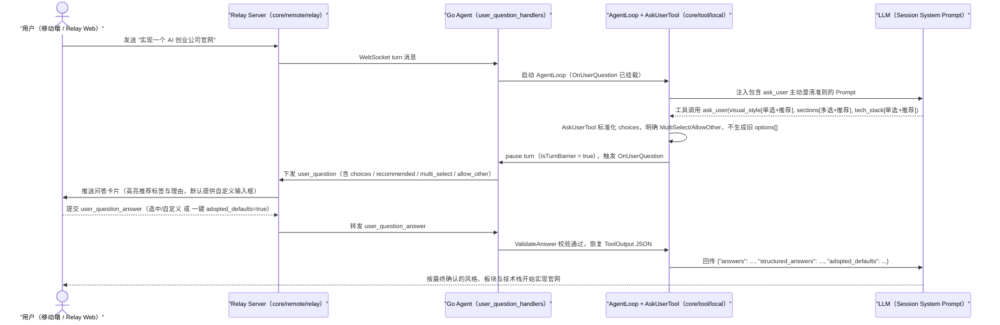

# Go 后端主动澄清询问（Proactive `ask_user`）与结构化推荐方案设计

> 本文为 **Go 后端独立实施方案**（覆盖 `core/session/`、`core/application/`、`core/domain/interaction/`、`core/tool/local/`、`core/remote/`、`core/service/` 与 `core/remote/relay/web/`），聚焦解决当前 Agent “缺乏主动向用户确认需求、不会给出带理由的自主建议、缺少多选与默认自定义回复能力”的问题。配套移动端实现见 [移动端主动澄清卡片与推荐/多选/自定义交互方案](FEATURE_MOBILE_PROACTIVE_ASK_USER_PLAN.md)。

---

## 1. 背景与后端现状诊断

通过源码排查，当前工程其实已经打通 **本地工具 `ask_user` → Relay 暂停等待 → 移动端/Web 问答卡片 → 恢复 Agent Loop** 的底层基础设施：

- **工具注册与权限边界**：`core/App.go` 已注册 `local.NewAskUserTool()`；`AskUserTool` 实现了 `TurnBarrier` 与 `UserInteraction`（`core/tool/local/ask_user.go`）；`core/application/tool/service/selection_service.go` 对 `ask_user` 放开了 `allowlist` 限制，且 `ModePolicy.AllowsToolPermission`（`core/application/runtime/service/mode_policy.go`）在 Plan 模式下允许 `PermissionRead` 工具执行。
- **实时与后台双通道**：移动端聊天通过 `ChatStreamHandler.OnUserQuestion` 接入 `agent.askUserQuestion`（默认 15 分钟超时等待，`core/remote/agent/chat_handlers.go`、`core/remote/agent/user_question_handlers.go`）；后台连续轮次通过 `ChatService.ListBackgroundQuestions` / `ResolveBackgroundQuestion`（`core/service/chat_background_events.go`）与 Relay 待办交互缓存（`core/remote/relay/interactions.go`）支持断线重连恢复。

但之所以线上体感像是“没有主动询问功能”，根因在于以下 **5 个明确的提示词与协议缺口**：

| 模块 | 现状与代码定位 | 具体缺口 |
| :--- | :--- | :--- |
| **全局工具提示** | `core/session/Session.go`（`systemPrompt`） | `Tool usage:` 列出了 12 类本地工具，却**完全漏写了 `ask_user`**；仅在 `Safety:` 末尾留有一句泛泛的 *“Ask for clarification when the user's intent is risky or ambiguous.”*，模型倾向直接开写代码或用纯文本反问（结束当轮，不弹交互卡片）。 |
| **工具描述导向** | `core/tool/local/ask_user.go`（`Description()`） | 文案偏向保守（*“Do not ask questions that can be safely resolved from context”*），既没有定义开放式/创作型任务（如“实现 xxx 官网”）的主动澄清场景，也没有要求输出“AI 推荐选项 + 推荐理由”。 |
| **Plan / Auto-Plan 冲突** | `core/application/runtime/service/runtime_instruction_builder.go`（`PlanModePrompt` / `AutonomousPlanPrompt`） | 分别引导模型 *“state the question or assumption clearly”* 与 *“Do not ask the user for approval”*，导致模型在规划阶段把缺失信息写成静态文本假设而非调用 `ask_user` 获取真实偏好。 |
| **`allow_other` 默认值陷阱** | `core/tool/local/ask_user.go`（第 71、86-88 行） | 结构体采用 `AllowOther bool`，仅在 `len(Options) == 0` 时设为 `true`。只要模型提供了 `options` 但忘记显式传 `"allow_other": true`，客户端就会隐藏自定义输入框，且领域校验 `ValidateAnswer` 会拦截自定义文本。 |
| **Schema 与答案协议受限** | `core/domain/interaction/question.go`、`core/remote/protocol/message.go` | 当前 `Question` 只有扁平 `Options []string`，`Answer` 只有 `Answers map[string]string`；两者都不能表达推荐理由、多选集合、预设与补充说明共存或“按推荐方案一键开始”。 |

---

## 2. 端到端交互架构与时序

以下以一个**全新、无法从工作区推断品牌方向或技术约束**的“实现一个 AI 创业公司官网”任务为例；若仓库已有明确技术栈/设计系统，或这些偏好对交付影响较低，应跳过相关提问并采用默认值。



---

## 3. 前后端统一线协议契约（Wire Contract）

本功能采用单一的新协议，不保留旧版字符串 `options`、纯文本 `answers`、字段回退或双写逻辑。Go 后端、移动端与 Relay Web 必须按同一版本协同发布；不匹配时明确报协议版本错误，不静默降级、不伪装成支持。

### 3.1 下行问题载荷

适用于实时 `user_question`、`background_turn_event` 和 `user_question_list_result`；Question payload 的 `schema_version` 固定为 `2`：

| 字段路径 | 类型 | 必填 | 说明 |
| :--- | :--- | :--- | :--- |
| `payload.schema_version` | `int` | 是 | 固定为 `2`。 |
| `questions[].id` | `string` | 是 | 问题唯一标识；由工具生成，不允许空值或重复。 |
| `questions[].prompt` | `string` | 是 | 面向用户的简洁问题。 |
| `questions[].choices` | `UserQuestionOptionPayload[]` | 是 | 统一使用结构化选项；每项包含 `label`、可选 `description` 与可选 `recommended`。 |
| `questions[].multi_select` | `bool` | 是 | 明确指定单选或多选，不依赖缺省值推断。 |
| `questions[].allow_other` | `bool` | 是 | 明确指定是否开放自定义输入；工具入口默认设置为 `true`。 |

不再发送旧版 `options: string[]`。客户端只读 `choices`，收到缺少必需字段或未知 schema 版本时显示明确错误并停止提交。

### 3.2 上行回答载荷

`user_question_answer` 只接受结构化答案，不再接收或推导 `answers: Record<string,string>`：

| 字段路径 | 类型 | 必填 | 说明 |
| :--- | :--- | :--- | :--- |
| `schema_version` | `int` | 是 | 固定为 `2`；不支持其他版本时明确报错。 |
| `question_id` | `string` | 是 | 对应待回答问题。 |
| `structured_answers` | `Record<string, UserQuestionStructuredAnswerPayload>` | 是 | 每题包含 `selected?: string[]` 与 `other?: string`；多选允许二者共存，单选互斥。 |
| `adopted_defaults` | `bool` | 否 | 用户通过快捷按钮采纳推荐时为 `true`。 |
| `cancelled` | `bool` | 否 | 用户选择跳过本轮澄清。后端返回显式 `Skipped`，不作为工具异常；有可靠安全默认时按默认继续，否则只做不依赖该决策的工作，并清楚说明阻塞点，不擅自替用户作高影响决定。 |

摘要只用于卡片本地回显；若模型需要可读文本，由后端基于结构化答案生成，不接受客户端提交第二份可冲突的答案。

### 3.3 发布与版本边界

- Go 后端、Mobile 与 Relay Web 作为一个功能版本协同发布，统一使用 `schema_version: 2` 及结构化 `choices` / `structured_answers`。
- 不实现旧字段解析、字符串选项解码、旧客户端单选降级或双写。发现缺字段、非法结构或版本不匹配时返回可诊断错误；部署说明要求客户端和服务端一起升级。
- 此处“不兼容旧协议”是明确的产品取舍，不等于取消当前仍有价值的基础交互：单选、多选、自定义回答和推荐采纳都属于新协议本身。

## 4. 领域模型与校验规则升级（`core/domain/interaction/question.go`）

领域对象保持显式语义：`AllowOther` 是普通 bool，不在领域层暗中启用；只有面向 LLM 的工具入口在模型未作决定时按产品约定将其设为 `true`，随后在所有传输载荷中显式发送。

### 4.1 核心结构体定义

```go
package interaction

type Option struct {
	Label       string `json:"label"`
	Description string `json:"description,omitempty"`
	Recommended bool   `json:"recommended,omitempty"`
}

type Question struct {
	ID          string
	Prompt      string
	Choices     []Option
	MultiSelect bool
	AllowOther  bool
}

type QuestionAnswer struct {
	Selected []string `json:"selected,omitempty"`
	Other    string   `json:"other,omitempty"`
}

type Answer struct {
	Structured      map[string]QuestionAnswer
	AdoptedDefaults bool
	Cancelled       bool
}
```

### 4.2 标准化与校验逻辑（`ValidateRequest` / `ValidateAnswer`）

1. **`ValidateRequest(request Request) error`**：题数限制为 `1..5`；每题 `id`、`prompt` 非空且 `id` 不重复；`Choices` 数量为 `0..8`；选项 `Label` trim 后非空且不重复。工具入口负责填充必需的 `MultiSelect` 与 `AllowOther` 值。
2. **推荐选项约束**：单选最多一个 `Recommended`；多选可以有多个。模型误标多个单选推荐项时工具层仅保留首个并记录修正，避免把可修复的展示瑕疵变成整轮失败。
3. **`ValidateAnswer(request, answer)`**：只接受 `answer.Structured`，先校验题目 ID 集合与请求完全一致，再对每题清洗 `Selected`（trim、去重、保序）及 `Other`（trim）；至少一个非空答案；选中标签必须属于该题 `Choices`；单选不能同时有预设选项和自定义文本，且最多选一个；多选可让 `Selected` 与 `Other` 共存；`Other` 非空时必须满足 `AllowOther`。不再接受纯文本摘要作为答案或校验回退。
5. **取消语义**：用户跳过时返回显式 `Skipped`/`Cancelled` 结果，不作为校验错误；若存在安全默认则按默认继续，否则停止受该决策阻塞的部分并说明原因，不立刻重复提问。

## 5. `ask_user` 工具升级（`core/tool/local/ask_user.go`）

### 5.1 工具 Description 与 JSON Schema

工具描述强调“只澄清高影响、确实未决的选择”，不把“需求宽泛”本身当作提问理由。工具输入只接受单一结构化 schema：`decision_impact` 必须为 `high`，`decision_reason` 说明具体影响和为什么上下文无法消歧；`choices` 只接受对象，不再接受字符串数组。

新工具调用示意：

```json
{
  "decision_impact": "high",
  "decision_reason": "仓库和对话都没有品牌规范；视觉方向会决定整站布局和素材，选错会导致大范围返工。",
  "context_evidence": [
    { "source": "workspace", "path": "README.md", "finding": "未找到品牌/视觉规范" },
    { "source": "conversation", "finding": "用户未指定目标受众或视觉风格" }
  ],
  "safe_default_if_skipped": "采用简洁、易读的企业级默认风格；如仍无法安全确定则暂不实现依赖该选择的部分。",
  "title": "确认官网方向",
  "questions": [{
    "id": "visual_style",
    "prompt": "官网整体采用什么视觉风格？",
    "multi_select": false,
    "allow_other": true,
    "choices": [
      { "label": "深色科技感", "description": "适合 AI 基础设施产品，视觉识别鲜明。", "recommended": true },
      { "label": "明亮企业风", "description": "更突出可信赖与易读性。" }
    ]
  }]
}
```

Schema 要求 `decision_impact: "high"`、`decision_reason`、`context_evidence`、`title`、`questions`，以及每题的 `id`、`prompt`、`multi_select`、`choices`；`context_evidence` 至少包含一条会话/历史或工作区证据。工作区证据必须带实际检查过的相对路径；会话证据不得伪称为仓库检查。`safe_default_if_skipped` 可选；没有安全默认时留空。`allow_other` 可省略并按产品默认 `true` 显式写入领域对象。每个 `choices` 元素是 `{label, description?, recommended?}`，没有字符串联合类型。

### 5.2 严格解码、校验与工具结果

1. **严格输入解码**：拒绝字符串型 choice、未知字段、缺少必需字段和错误类型；不做旧格式解析或静默修复。仅做安全规范化：trim 空白、截断过长说明；必需 ID 缺失时直接拒绝，不临时造 ID 掩盖模型错误。
2. **可修复推荐标记**：单选误标多个推荐项时保留第一个并记录一次结构化告警；这是对当前请求内容的容错，不是旧协议兼容。其余结构错误直接返回可诊断工具错误。
3. **回答输出**：成功时只返回 `{structured_answers, adopted_defaults}`；取消时返回 `{skipped: true}`，绝不把取消转成工具异常；Agent 只有在存在安全默认时才继续该决策，若无默认则暂停相关实现并说明阻塞点。可读摘要由服务端按规范化后的结构生成，作为模型上下文辅助，不作为第二份协议答案。
4. **运行时门禁**。同一 Agent turn 通常问 1 轮、每轮 1~3 题，协议每轮最多 5 题。第一轮收到有效回答后才允许第二轮，由主 Agent 判断回答是否揭示了此前无法预见的另一个高影响阻塞点。首轮仍在等待、已跳过或未收到有效回答时，本轮拒绝追问。服务端校验 `decision_impact`、`decision_reason` 和题目结构，并核对 `context_evidence` 中的工作区路径与本轮成功的 `list_files`、`read_file` 或 `search_files` 检查记录。公开问题卡片、远程工具事件和历史载荷均剔除内部证据与 `safe_default_if_skipped`。

## 6. 主动提问 Prompt 工程与防打扰护栏

### 6.1 修改 `core/session/Session.go`

在 `systemPrompt` 的 `Tool usage:` 中新增 `ask_user` 专条（建议放在 `get_environment` / `spawn_agent` 之间），并收紧 `Safety:` 中模糊的一句话：

- **`Tool usage:` 新增规则要点**：
  1. 显式点名工具 `ask_user`，说明：当确实需要用户决定高影响偏好、目标、架构取舍或范围边界时，应调用该工具；不要只用纯文本提问后结束本轮。
  2. **主动触发场景（先判断是否值得问）**：
     - 开放式/创作型需求（如官网、落地页、后台或新应用）本身不自动触发问卷。先检查工作区、对话上下文与已有设计约束；只有当仍存在会显著改变交付、无法可靠推断且选错会造成明显返工的决策时，才在开始该决策相关的实现前调用 `ask_user`。
     - 对低影响、可逆或有明显行业默认值的选择，优先采用合理默认值并简要说明假设，不要为了补齐偏好清单而打断用户。
     - 对多套不兼容且高代价的方案（如静态单页 vs 全栈工程、破坏性重构 vs 增量兼容），应先查明仓库和上下文已有信息；若仍无法安全选择，再向用户确认。
  3. **结构化建议规范（怎么问得好）**：
     - 通常控制在 **1 轮、1~3 个高价值问题**；只有确有多个相互独立且影响交付的决策时才增加题数（最多 5 题），避免把宽泛请求变成必答问卷；选择题提供 **2~5 个具体选项**；纯开放文本题可不设选项，但仅在确有必要时使用；
     - 对确实需要用户选择的题目，把最合理方案放前并标记 `recommended: true`，在 `description` 简述推荐理由/适用场景；若无法给出有依据的推荐，不要为了满足格式而伪造理由或强行标记推荐；
     - 功能模块、页面区块类题优先启用 `multi_select: true`；保持 `allow_other` 默认开启，让用户随时可叠加补充或自由输入。
  4. **防打扰护栏（何时绝对不要问）**：
     - 具体明确的改动/修复（如“修一下登录报错”“把 `Button.tsx` 的内边距改成 12”“解释某函数”）直接读取代码并执行；
     - 能用 `list_files` / `read_file` / `search_files` 从工作区自行查明的事实（如项目已有框架、依赖、配色体系），先查文件，**严禁拿工作区已有答案去问用户**；
     - 同一任务通常只问 1 轮（最多 2 轮）；若用户点击取消（`the user chose not to answer`），停止追问；有安全默认则采用并说明，否则只做不受该决定影响的部分并说明阻塞点。
- **`subagentSystemPrompt` 与 `core/domain/subagent/builtin.go`**：
  - 保持子代理**不做主动产品发散提问**：`subagentSystemPrompt` 已有 `- Do not ask what the user wants...`，在说明中补充一句“不要在子任务中发起探索性需求问卷；仅在遇到父代理未授权的关键外部决策阻塞时才使用 `ask_user`”。

### 6.2 修改 `core/application/runtime/service/runtime_instruction_builder.go`

- **`PlanModePrompt`（第 28 行附近）**：
  - 将原 `- If information is missing, state the question or assumption clearly.` 调整为：
    - 先检查工作区与上下文；仅当仍有显著影响交付、无法可靠推断且选错代价高的偏好/范围决策时，才在最终编号 Plan 前调用一次 `ask_user` 并提供有依据的推荐。低影响或可逆事项直接采用合理默认值，在 Plan 中标明假设；用户跳过时，有安全默认则说明并采用，否则停止受阻部分并报告，不得臆造高影响决策。
- **`AutonomousPlanPrompt`（第 44 行附近）**：
  - 明确区分“执行前不要索要计划审批”和“高歧义需求可做一轮前置澄清”：
    - 保留 `- Do not ask the user for approval after producing the Plan. The application will immediately execute the plan after this planning phase.`
    - 增加一句：仅当检查工作区和上下文后仍有无法可靠推断、且会显著改变执行结果的关键决策时，才可在输出 `Plan` 之前调用一次 `ask_user`；低影响事项采用默认值并说明假设；用户跳过澄清且没有安全默认时，只规划独立可执行部分并明确阻塞项。收到回答后立即产出完整可执行计划，不再索要计划审批。

### 6.3 是否提问的具体判定策略

不使用“消息很短/任务很宽泛/出现官网或 App 等关键词”这类关键词规则，也不额外增加一次分类模型调用。主 Agent 在任务理解/Plan 阶段复用当前模型调用中的判断，不增加独立分类器成本。由主 Agent 在现有规划过程中按以下结构化检查作判断；仅当结论为“问”时才调用 `ask_user`，并将 `decision_impact: high` 与具体阻塞理由写入必填的 `decision_reason`，用于调试、审计和评估；运行时拒绝非 high impact、空理由和超出轮数的调用。

| 检查项 | 必须满足的判定 | 不满足时的处理 |
| :--- | :--- | :--- |
| 用户是否已决定 | 对话中没有明确选择，也没有“你自行决定/不要问我”等委托或免问指示。 | 尊重用户已给选择或授权，直接执行。 |
| 是否仍未知 | 先检查用户消息、历史上下文和相关项目文件；候选决策仍无法从中确定。 | 能从上下文/仓库查明的先查明，不问用户。 |
| 是否影响重大 | 不同答案会实质改变范围、架构、数据模型、外部行为、核心受众/品牌方向，或带来明显成本/风险差异。 | 低影响、可逆的细节采用合理默认值并可在结果中说明。 |
| 猜错代价是否高于打断成本 | 没有安全、可信且返工成本低的默认方案；错误选择会造成明显返工或难以逆转。 | 有可靠默认且更便宜，就先采用默认。 |
| 是否适合提问 | 能把未决点压缩成用户可理解的一题，并给出互斥或可组合的具体选项。 | 若不能形成清晰问题，继续调查或选安全默认，不发散问卷。 |

可执行逻辑：`shouldAsk = !userDelegated && unresolvedAfterContextCheck && materialImpact && highCostOfWrongGuess && askableDecision`。五项须同时成立；“任务宽泛”不是独立触发条件。安全/权限确认走既有权限流程，不混入偏好澄清。

**执行位置与约束：**此判断放在 Agent 的任务理解/计划阶段，由主模型基于语义做评估；不采用脆弱的正则关键词打分。`ask_user` 工具负责校验 `decision_reason`、问题数量、单/多选和选项结构，并按 turn 限制提问轮数。测试以成对案例验证“该问”和“不该问”，上线后观察提问率、取消率、用户修改推荐比例及因默认选择导致的返工反馈，再调提示词与阈值。

#### 6.3.1 上下文如何检查（不是把整个仓库注入提示词）

检查分为“规则提示”与“事实取证”两部分：

1. **规则提示**：`Session.go` / `RuntimeInstructionBuilder` 注入的是何时检查、何时提问、何时采用默认值的决策规则，不注入整仓库文件内容。
2. **事实取证**：Agent 先从当前用户消息和近期对话读取已明确偏好；若未决点依赖项目事实，再按需调用现有只读工具 `list_files`、`read_file`、`search_files`。例如核对前端栈时优先查看 `package.json` / `README.md`；核对已有视觉规范时查看相关主题、样式或页面文件。只读相关文件，不做全仓扫描。
3. **内部决策记录**：调用 `ask_user` 前提交 `context_evidence[]`（来源、工作区相对路径（如适用）、简短发现）、`decision_reason`、`decision_impact` 与可选 `safe_default_if_skipped`。这些字段仅供模型工具输入和服务端审计，既不传给用户端，也不作为模型可执行指令。
4. **运行时可核验性**：工具运行上下文记录本 turn 成功完成的只读检查事件。若模型声称从工作区发现了事实，服务端至少验证对应路径/检查事件确实发生后才允许 `ask_user`；会话证据则不要求工作区工具调用。此门禁能防止“声称检查但没有读文件”，但不能代替模型对文件内容的语义理解。
5. **不可信文件内容边界**：读取文件是为了提取项目事实；文件中的任意文本不自动成为用户的新指令，不能覆盖系统策略或当前用户请求。

示例：若 `package.json` 已显示 React/Vite 且主题文件已有品牌色，就沿用并跳过技术栈/视觉体系问题；若工作区为空且对话没有受众、品牌或范围信息，再评估这些选择是否高影响。若检查工具不可用，不得声称已检查：低影响事项采用合理默认，高影响且无安全默认时停止相关实现并说明阻塞点。

### 6.4 效果示例（“实现一个 AI 创业公司官网”）

当用户在仓库和对话没有提供品牌/范围信息，且不同选择会显著影响返工时，Agent 才发起的 `ask_user` 调用示例：

```json
{
  "decision_impact": "high",
  "decision_reason": "检查工作区和对话后都没有品牌规范；视觉方向会决定整体布局与素材，猜错会造成较大返工。",
  "context_evidence": [
    { "source": "workspace", "path": ".", "finding": "list_files 检查未发现产品/品牌说明" },
    { "source": "conversation", "finding": "用户未指定受众或视觉方向" }
  ],
  "safe_default_if_skipped": "先采用简洁、易读的企业级默认；若这仍不足以安全推进，则暂停依赖该决定的实现并说明阻塞点。",
  "title": "确认官网设计方向与功能板块",
  "questions": [
    {
      "id": "visual_style",
      "prompt": "官网整体采用什么视觉风格？",
      "multi_select": false,
      "allow_other": true,
      "choices": [
        {
          "label": "极简深色科技感（推荐）",
          "description": "高对比深色画布 + 玻璃拟态与细腻微交互，最贴合 AI 基础设施 / SaaS 产品定位",
          "recommended": true
        },
        {
          "label": "清爽浅色编辑风（Linear / Notion 感）",
          "description": "大留白、清晰排版层级与柔和描边，突出企业级可信度与文档阅读感"
        },
        {
          "label": "高饱和梯度创意视觉",
          "description": "大胆色彩渐变与视觉冲击，适合面向 C 端创作者/设计工具品牌"
        }
      ]
    },
    {
      "id": "page_sections",
      "prompt": "首版官网需要包含哪些核心板块？（可多选）",
      "multi_select": true,
      "choices": [
        {
          "label": "首屏 Hero + 交互演示区",
          "description": "核心价值主张、CTA 按钮与产品预览动效，提升首屏转化率",
          "recommended": true
        },
        {
          "label": "核心能力 / 使用场景卡片",
          "description": "用 3~4 个典型落地场景直观展示产品优势",
          "recommended": true
        },
        {
          "label": "定价方案与 FAQ",
          "description": "清晰对比免费版/团队版/企业版权益并解答常见疑问",
          "recommended": true
        },
        {
          "label": "客户案例与联系表单",
          "description": "Logo 墙、评价证言及预约 Demo 表单"
        }
      ]
    },
    {
      "id": "tech_stack",
      "prompt": "优先采用哪种代码实现形式？",
      "multi_select": false,
      "allow_other": true,
      "choices": [
        {
          "label": "当前项目现有前端技术栈 / 纯净 HTML+CSS+JS",
          "description": "零额外构建负担、可直接在浏览器预览或无缝融入现有目录（我将先检查当前工作区）",
          "recommended": true
        },
        {
          "label": "React + Tailwind CSS + Vite 工程",
          "description": "组件化结构清晰，方便后续接入路由、国际化与 CMS"
        }
      ]
    }
  ]
}
```

---

## 7. Relay 协议、Waiter 寄存、后台 Turn 与 Relay Web 统一协议实现

### 7.1 `core/remote/protocol/message.go`

```go
type UserQuestionOptionPayload struct {
	Label       string `json:"label"`
	Description string `json:"description,omitempty"`
	Recommended bool   `json:"recommended,omitempty"`
}

type UserQuestionPayload struct {
	SchemaVersion int                        `json:"schema_version"`
	QuestionID    string                     `json:"question_id"`
	Title         string                     `json:"title,omitempty"`
	Questions     []UserQuestionItemPayload `json:"questions"`
}

type UserQuestionItemPayload struct {
	ID          string                      `json:"id"`
	Prompt      string                      `json:"prompt"`
	Choices     []UserQuestionOptionPayload `json:"choices"`
	MultiSelect bool                        `json:"multi_select"`
	AllowOther  bool                        `json:"allow_other"`
}

type UserQuestionStructuredAnswerPayload struct {
	Selected []string `json:"selected,omitempty"`
	Other    string   `json:"other,omitempty"`
}

type UserQuestionAnswerPayload struct {
	SchemaVersion     int                                            `json:"schema_version"`
	QuestionID        string                                         `json:"question_id"`
	StructuredAnswers map[string]UserQuestionStructuredAnswerPayload `json:"structured_answers"`
	AdoptedDefaults   bool                                           `json:"adopted_defaults,omitempty"`
	Cancelled         bool                                           `json:"cancelled,omitempty"`
}
```

### 7.2 传输转换与深拷贝点

| 文件 | 函数 | 改造内容 |
| :--- | :--- | :--- |
| `core/remote/agent/user_question_handlers.go` | `userQuestionPayload` | 只转换 `Choices`、`MultiSelect`、`AllowOther`，所有字段按新 schema 输出。 |
| `core/remote/agent/user_question_handlers.go` | `handleUserQuestionAnswerContext` | 仅解析 `StructuredAnswers`，转换为领域结构化回答并透传 `AdoptedDefaults`；取消时产生显式 `Skipped` 结果。 |
| `core/remote/agent/user_question_waiters.go` | `list` | 返回活跃问题快照时深拷贝 `Choices` 及其字段，避免并发共享可变切片。 |
| `core/service/chat_background_events.go` | `cloneBackgroundEvent` / `ResolveBackgroundQuestion` | 深拷贝问题 `Choices` 和结构化答案（含 `Selected`），准确保留推荐采纳/跳过状态。 |
| `core/remote/relay/interactions.go` | `interactionFromMessage` | Relay 缓存完整的新协议消息；增加快照往返测试，任何缺字段的旧消息按协议错误处理，不做回退。 |

### 7.3 Relay 调试网页实现

Relay Web 使用 schema v2 处理前台和后台问答。卡片展示 `choices` 的推荐标记与理由，按 `multi_select` 使用单选或多选控件，并依据 `allow_other` 显示自定义输入。还有未答题且这些题均有推荐项时，用户可一键填完并提交，已填答案继续保留。断线后通过待答快照核对提交状态。服务端确认同一问题仍待答时，页面保留内存草稿并允许重试。


## 8. 后端分步实施清单与测试验收计划

### 8.1 改动文件总览

| 序号 | 文件路径 | 核心变更 |
| :--- | :--- | :--- |
| 1 | `core/domain/interaction/question.go` | 新增 `Option`、`QuestionAnswer`、扩展 `Question` 与 `Answer`、升级 `ValidateRequest` / `ValidateAnswer`。 |
| 2 | `core/tool/local/ask_user.go` | 升级 `Description()` 与 `Schema()`；仅接受结构化 `choices`、`AllowOther` 默认值、单选推荐标记校验、结构化输出与跳过语义。 |
| 3 | `core/session/Session.go` | 在 `systemPrompt` 中系统化引入 `ask_user` 主动触发条件、建议规范与防打扰护栏；完善 `subagentSystemPrompt` 边界说明。 |
| 4 | `core/domain/subagent/builtin.go` | 在内置子代理 SystemPrompt 中明确非必要不向用户发起探索性发散提问。 |
| 5 | `core/application/runtime/service/runtime_instruction_builder.go` | 对齐 `PlanModePrompt` 与 `AutonomousPlanPrompt`，允许制定编号 Plan 前先调用 `ask_user` 收敛高歧义需求。 |
| 6 | `core/remote/protocol/message.go` | 扩展 `UserQuestionOptionPayload`、`UserQuestionItemPayload`、`UserQuestionStructuredAnswerPayload`、`UserQuestionAnswerPayload`。 |
| 7 | `core/remote/agent/user_question_handlers.go` | 转换结构化选项与结构化回答，规范化结构化答案并生成服务端摘要。 |
| 8 | `core/remote/agent/user_question_waiters.go` | 列表快照深拷贝 `Choices`。 |
| 9 | `core/service/chat_background_events.go` | 后台交互事件克隆与解析同步深拷贝 `Choices` / `Structured` / `AdoptedDefaults`。 |
| 10 | `core/remote/relay/web/index.html`、`app.js` | 支持新协议推荐、多选、共存自定义及一键采纳推荐，只发送 `structured_answers`。 |

### 8.2 单元测试与集成验证

1. **`core/domain/interaction/question_test.go`**：
   - 更新领域测试以只验证新结构化协议，不保留旧纯文本答案测试；
   - 新增：多选共存校验（`Selected` + `Other`）、单选互斥拦截、单选推荐约束、`allow_other: false` 拒绝自定义、摘要由结构化答案生成、缺失/未知字段和错误类型拒绝、取消返回 `Skipped` 而非工具错误。
2. **`core/tool/local/ask_user_test.go`**：
   - 删除旧字符串数组选项与纯文本答案测试；
   - 新增：结构化 `choices[{label,description,recommended}]` 解码、字符串 choice 与未知字段严格拒绝、显式 `allow_other` 默认与关闭行为、单选多推荐仅保留首项并产生告警、`ToolOutput` 只使用新 JSON 格式。
3. **上下文检查门禁测试**：没有对应成功只读工具事件时，workspace `context_evidence` 不得通过；有匹配 `list_files` / `read_file` / `search_files` 事件时允许继续语义判定；文件内容中的提示注入文本不得改变系统规则。
4. **`core/remote/agent/permission_identity_test.go` / `background_turns_test.go`**：
   - 测试新协议 `choices`、`multi_select`、`structured_answers`、`adopted_defaults` 往返与断线重连快照；覆盖协议缺字段时明确报错，不执行旧格式回退。
5. **`core/service/chat_background_events_test.go` 与 `core/remote/relay/interactions_test.go`**：
   - 测试后台 turn 提问与 Relay 缓存重放新字段无损。
6. **主动提问判定评测（Prompt Eval）**：使用成对用例验证五个门槛；应问例：空仓库新建品牌官网且用户未授权 Agent 自主决定；不应问例：已有明确设计系统、用户说“按项目现状自行决定”、明确修复 bug、可从代码读出的技术栈、只涉及可逆微样式。要求前者提出最少必要问题，后者直接执行或说明默认值。
7. **回归命令**：
   ```powershell
   go test ./core/domain/interaction/... ./core/tool/local/... ./core/remote/... ./core/service/... ./core/application/...
   ```
