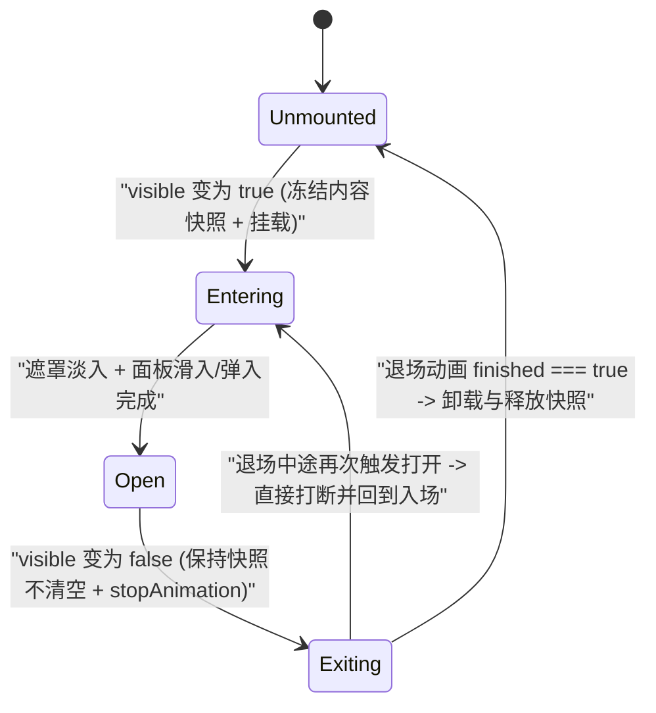
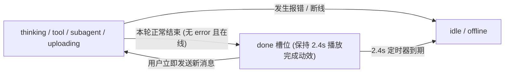

# 移动端交互动效丢失与画面失真修复方案

> 本文梳理并制定 MyAI 移动端（`mobile/`，Expo SDK 56）在**交互确认/取消动效丢失、退场半空坍塌、`done` 状态缺失**以及**小头像/聊天图片/壁纸/光环画面失真**等方面的根因分析与分批改造方案。与图片预览高清升级、本地持久化缓存的协同关系见 [生图、预览与图片持久化方案](FEATURE_IMAGE_GENERATION_IMPLEMENTATION.md)。

---

## 1. 背景与问题总览

结合真机交互逻辑与源码逐行核对，当前移动端存在两大类视觉与动效缺陷：
1. **交互动效丢失、瞬移或退场坍塌**：点击“确认”或“取消”后，弹窗或卡片在退场途中被掏空、直接卸载、或者出现 0ms 生硬消失；此外 7 槽位吉祥物中的 `done`（完成确认）动效在真实对话中从未触发。
2. **画面失真与构图裁切**：小圆形头像直接缩放全身立绘导致五官糊成像素块；聊天卡片将任意比例截图与透明/动图强制压缩为白底 JPEG 且以 `16:10` `cover` 暴裁；壁纸开启模糊时在 Android 上产生高倍下采样色块；角色光环框线横切角色肩颈。

| 问题类别 | 用户可感知现象 | 代码根因位置 | 严重程度 |
| :--- | :--- | :--- | :--- |
| **确认/拒绝退场坍塌** | `PermissionSheet` 点「允许」或「拒绝」的瞬间，命令框和标题突然消失，底部弹窗先缩成空壳再滑下 | `mobile/src/components/permissions/PermissionSheet.tsx#L39-L48`、`mobile/src/screens/MobileAppScreen.tsx#L1816-L1840` | 高 |
| **取消/确认动画 0ms 丢失与文字闪变** | `ConfirmModal` 部分入口直接被卸载完全无动画；删除对话/回滚快照退场瞬间文字闪变回“未命名对话 / 0 个文件”；打开瞬间抖动重播 | `mobile/src/components/common/ConfirmModal.tsx#L46-L73`、`mobile/src/components/settings/sections/MCPCatalogSection.tsx#L280-L290`、`mobile/src/components/sessions/SessionsPanel.tsx#L188-L202`、`mobile/src/components/changes/ChangesPanel.tsx#L137-L151` | 高 |
| **表单弹窗无退场 & 遮罩切割** | `ResponsiveFormModal` 点取消/保存瞬间闪烁消失，打开时全屏半透明黑底从底部往上推 | `mobile/src/components/common/ResponsiveFormModal.tsx#L44-L64`、`mobile/src/screens/MobileAppScreen.tsx#L1857-L1873` | 高 |
| **提问框 & 侧栏 & 停止反馈缺失** | `UserQuestionPrompt` 跳过/提交生硬跳变；`SideDrawer` 未适配减弱动态且连点抽搐；`Composer` 取消执行按钮无按压与触觉反馈 | `mobile/src/components/permissions/UserQuestionPrompt.tsx#L133-L164`、`mobile/src/components/navigation/SideDrawer.tsx#L52-L70`、`mobile/src/components/chat/Composer.tsx#L52-L68` | 中 |
| **`done` 完成态动效永不触发** | 任务结束后顶栏吉祥物直接从 `working` 切回 `idle`，`avatar-done.webp` / `done.webp` 从未播放 | `mobile/src/utils/agentActivity.ts#L52-L84`、`mobile/src/screens/MobileAppScreen.tsx#L1197-L1222` | 中 |
| **小圆形头像模糊变形** | 气泡/时间线 `24×24` 圆框塞进 `160×160` 全身立绘，脸部仅 ~6px 糊成一片；`AppHeader` 容器 `52×50` 非正方且与 `Spinner` 偏心 | `mobile/src/components/common/CharacterAvatar.tsx#L21-L65`、`mobile/src/components/layout/AppHeader.tsx#L135-L148`、`mobile/src/components/layout/AppHeader.tsx#L245-L261` | 高 |
| **聊天图片强裁切与压糊失真** | 竖图/方图/截图被 `16:10` `cover` 暴裁，叠加后端 `256 KiB` 最低 `quality: 50` 重压缩与白底化 | `mobile/src/components/chat/SharedAssetCard.tsx#L152`、`mobile/src/components/chat/styles.ts#L210` | 高 |
| **壁纸模糊块状色带 & 首帧闪现** | Android `dimezisBlurViewSdk31Plus` 高模糊度下呈现色块马赛克；视频壁纸首帧渲染瞬间从透明突兀闪出 | `mobile/src/components/chat/ChatWallpaperLayer.tsx#L86-L156` | 中 |
| **呼吸光环尺寸穿模** | `CharacterHalo` 的 `ringSize`（140/146/164）小于角色立绘高度（158/168/188），边框硬生生横切头像肩颈 | `mobile/src/components/common/MotionEffects.tsx#L114-L206`、`StartupLoadingOverlay.tsx#L125-L126`、`PairingScreen.tsx#L101-L102`、`ChatEmptyState.tsx#L127-L128` | 低 |

---

## 2. 交互动画修复方案（取消 / 确认 / 抽屉 / 提问 / 完成态）

### 2.1 `PermissionSheet` 确认/拒绝退场内容防坍塌

- **问题代码**：[MobileAppScreen.tsx](file:///d:/Go_All/myai/mobile/src/screens/MobileAppScreen.tsx#L1816-L1840) 在 `onAllow`、`onAllowSession`、`onDeny` 后立即将 `pendingPermission` 清空为 `null`；虽然外层 [BottomSheet.tsx](file:///d:/Go_All/myai/mobile/src/components/common/BottomSheet.tsx#L40-L48) 在 `visible` 变为 `false` 后维持 `mounted = true` 播放 `180ms` 下滑退场，但 [PermissionSheet.tsx](file:///d:/Go_All/myai/mobile/src/components/permissions/PermissionSheet.tsx#L39-L48) 直接按实时 `permission`（此时已是 `null`）渲染标题、命令体和权限行，导致刚点击确认/取消的第一帧，卡片内部内容瞬间被清空、高度骤减后再滑出。此外 `BottomSheet.tsx` 也未接入 `useReduceMotion()`。
- **改造要点**：
  1. 在 `PermissionSheet.tsx` 内部维护 `const lastPermissionRef = useRef<PermissionState | null>(null)`，当 `permission` 非空时更新快照；当 `visible && !permission` 或处于退场过程中时，继续使用 `lastPermissionRef.current` 渲染面板正文与按钮，保证 `180ms` 退场全程面板高度与文案完整。
  2. 为 `BottomSheet.tsx` 接入 `useReduceMotion()`，当开启减弱动态时取消位移弹性直接完成状态切换；在 `useEffect` 触发新动画前调用 `.stopAnimation()` 避免快速开关冲突，并在快速重新打开时（`visible` 在退场未完成前切回 `true`）保持平滑衔接。

### 2.2 `ConfirmModal` 进退场稳定性与全调用点对齐

- **问题代码**：
  1. **进场二次重播抖动**：[ConfirmModal.tsx](file:///d:/Go_All/myai/mobile/src/components/common/ConfirmModal.tsx#L46-L73) 的 `useEffect` 依赖数组包含 `mounted`（`[fade, mounted, reduceMotion, scale, visible]`）。`visible` 变 `true` 时先触发一次 `setMounted(true)` 并从 `0.88` 弹簧放大，随后因 `mounted` 变化再次触发 `useEffect`，把 `fade` 和 `scale` 硬重置回 `0`/`0.88` 重新播放一遍，形成肉眼可见的双重闪跳。
  2. **退场文案闪变**：[SessionsPanel.tsx](file:///d:/Go_All/myai/mobile/src/components/sessions/SessionsPanel.tsx#L188-L202) 与 [ChangesPanel.tsx](file:///d:/Go_All/myai/mobile/src/components/changes/ChangesPanel.tsx#L137-L151) 在 `onCancel` / `onConfirm` 时立刻将目标对象置 `null`（`confirmDeleteSession` / `confirmCheckpoint`），使 `ConfirmModal` 在 `140ms` 淡出缩小期间重渲染出 `"确定删除「未命名对话」吗？"` 或 `"还原 0 个文件"`。
  3. **条件卸载砍掉退场动画**：[MCPCatalogSection.tsx](file:///d:/Go_All/myai/mobile/src/components/settings/sections/MCPCatalogSection.tsx#L280-L290) 写成了 `{review ? <ConfirmModal ... visible /> : null}`，用户点“取消”或“信任此配置”把 `review` 清空后，整个组件直接卸载，完全丢失 `140ms` 退场动画。
- **改造要点**：
  1. 重构 `ConfirmModal.tsx` 的动画生命周期：`mounted` 仅通过 `useRef` 或不列入进场 `useEffect` 触发重播的条件，开合动画前先 `.stopAnimation()`，消除打开瞬间的双重重播抖动。
  2. 在 `ConfirmModal.tsx` 内部冻结快照：每次 `visible === true` 时把 `{ title, message, confirmLabel, cancelLabel, danger, icon }` 缓存到 `snapshotRef`；`visible === false` 退场期间锁死使用该快照渲染，退场结束 `setMounted(false)` 后再释放，彻底消灭退场文案跳变。
  3. 排查全部调用点（含 `MCPCatalogSection.tsx`、`SessionsPanel.tsx`、`ChangesPanel.tsx`、`MotionSettings.tsx`、`MobileAppScreen.tsx`），将 `{review ? <ConfirmModal visible /> : null}` 统一改为持久挂载 `<ConfirmModal visible={Boolean(review)} ... />`。

### 2.3 `ResponsiveFormModal` 独立遮罩淡入与弹簧升降退场重构

- **问题代码**：
  - [ResponsiveFormModal.tsx](file:///d:/Go_All/myai/mobile/src/components/common/ResponsiveFormModal.tsx#L44-L64) 直接使用系统 `<Modal animationType="slide">`，存在两处明显缺陷：
    1. 遮罩层 `styles.backdrop` 位于 `<Modal>` 内部并跟随 `slide` 一起移动，打开时呈现整块深色蒙层从底部上推、退场时整块往下掉的“黑板切屏感”；
    2. 全仓多处（[MobileAppScreen.tsx](file:///d:/Go_All/myai/mobile/src/screens/MobileAppScreen.tsx#L1857-L1873)、[KnowledgePanel.tsx](file:///d:/Go_All/myai/mobile/src/components/knowledge/KnowledgePanel.tsx#L573-L675)、[AIMemoryPanel.tsx](file:///d:/Go_All/myai/mobile/src/components/knowledge/AIMemoryPanel.tsx#L403-L533)、[SubagentPanel.tsx](file:///d:/Go_All/myai/mobile/src/components/subagents/SubagentPanel.tsx#L243-L300)）采用条件挂载 `{modalOpen ? <ResponsiveFormModal visible ... /> : null}`，导致无论按确认保存还是取消关闭，都**0ms 瞬消失**，没有任何退出过渡。
- **改造要点**：
  1. 切换为 `<Modal animationType="none" transparent statusBarTranslucent visible>` + 内部 `mounted` 驻留机制。
  2. **双轨动画分离**：背景遮罩（`backdrop`）独立做 `opacity` `0 <-> 1` 渐隐渐现（`180ms`）；前景表单 `sheet` 在紧凑屏（`compact`）做 `translateY` 底部弹簧滑入（`220ms` 滑出），在宽屏做 `opacity + scale (0.94 <-> 1)` 居中缩放弹出，并支持 `useReduceMotion()`。
  3. 在 `ResponsiveFormModal` 内部冻结退场期间的 `title`、`children` 与 `footer` 快照，避免关闭时子节点内容闪烁；同步把 `MobileAppScreen.tsx` 等调用处改为 `<ResponsiveFormModal visible={Boolean(...)} />` 控制显示，确保确认与取消均有完整退场动画。

### 2.4 `UserQuestionPrompt` 确认/取消过渡、`SideDrawer` 中断衔接与 `Composer` 停止反馈

- **`UserQuestionPrompt.tsx`**（[UserQuestionPrompt.tsx](file:///d:/Go_All/myai/mobile/src/components/permissions/UserQuestionPrompt.tsx#L133-L164)）：
  - 点击「暂不回答（取消）」或「确认提交」时，先触发轻量 `Haptics` 反馈并执行 `150ms` 轻度透明淡出与微缩收起（或切至已提交状态卡时的过渡动画），动画结束回调 `onAnswer`，避免对话流卡片突发跳动或消失。
- **`SideDrawer.tsx`**（[SideDrawer.tsx](file:///d:/Go_All/myai/mobile/src/components/navigation/SideDrawer.tsx#L52-L70)）：
  - 接入 `useReduceMotion()`；开合动画调用前先 `.stopAnimation()`；退场逻辑加 `if (!mounted) return` 保护避免首屏挂载无效运行退场动画，支持快速滑动/连点打断后从当前 `slide` 值平滑衔接，并在关闭后延时清理搜索词 `query`。
- **`Composer.tsx`**（[Composer.tsx](file:///d:/Go_All/myai/mobile/src/components/chat/Composer.tsx#L52-L68)）：
  - 对话停止/取消按钮（`showStop` 状态）补齐与发送按钮对称的按压缩放反馈与轻触震动，避免取消生成操作“点下去像没反应”。

### 2.5 激活 7 槽位吉祥物的 `"done"` 完成确认动效

- **问题代码**：[agentActivity.ts](file:///d:/Go_All/myai/mobile/src/utils/agentActivity.ts#L4-L84) 声明了 `"done"` 枚举，资源表也内置了 `done.webp` / `avatar-done.webp`，但 `agentActivity()` 在 `!pendingRequestID` 时直接返回 `"idle"`，代码全链路没有任何一处产出过 `"done"`。
- **改造要点**：
  - 在 `MobileAppScreen.tsx`（或封装到 `agentActivity.ts` 的轻量 Hook `useActivityWithDoneHold`）中跟踪上一个 `AgentActivity` 状态及最近一次运行是否正常收尾（非错误、非离线）：
  - 当活动态从 `"thinking"` / `"tool"` / `"subagent"` / `"uploading"` 转回 `"idle"` 且最后一条运行/消息非失败态时，**保持 `"done"` 状态 `2400ms`**，驱动顶栏岛 `AppHeader` 播放完成动效（`avatar-done.webp` / `done.webp`），超时后平滑切换回 `"idle"`。如期间用户发起新一轮提问，则立即取消定时器进入新状态。

---

## 3. 画面失真与视觉品质修复方案（头像 / 预览图 / 壁纸 / 光环）

### 3.1 小尺寸圆形角色头像高清半身特写重切与 `CharacterAvatar` 几何修正

- **问题定位**：
  1. 现有 `mobile/assets/motion/avatar-*.webp` 为 `160×160` 全身透明立绘，在 [AgentTurnCard.tsx](file:///d:/Go_All/myai/mobile/src/components/chat/AgentTurnCard.tsx#L119)、[AssistantLoadingBubble.tsx](file:///d:/Go_All/myai/mobile/src/components/chat/AssistantLoadingBubble.tsx#L26)、[UserQuestionPrompt.tsx](file:///d:/Go_All/myai/mobile/src/components/permissions/UserQuestionPrompt.tsx#L57)、[PermissionSheet.tsx](file:///d:/Go_All/myai/mobile/src/components/permissions/PermissionSheet.tsx#L51) 的 `24×24` / `42×42` 圆框内使用 `contentFit="contain"`，人物脸部仅剩约 `6×6` 像素，降采样后面部严重糊成色块，四周空白过大。
  2. [CharacterAvatar.tsx](file:///d:/Go_All/myai/mobile/src/components/common/CharacterAvatar.tsx#L41-L62) 中圆角写成 `size / 2`，当外部传入 `height !== size` 时圆形会失真为胶囊/椭圆；`transform` 先写 `translateY` 再写 `scale`，与 `MotionSettings` 滑块调节直觉不一致。
  3. [AppHeader.tsx](file:///d:/Go_All/myai/mobile/src/components/layout/AppHeader.tsx#L135-L148) 顶栏头像容器 `avatarContainer` 宽高为 `52×50`（[AppHeader.tsx#L245-L261](file:///d:/Go_All/myai/mobile/src/components/layout/AppHeader.tsx#L245-L261)），内置 `<CharacterAvatar height={52} size={52}>` 配合 `size={50}` 的 `Spinner` 会造成上下 2px 裁切与偏心错位。
- **改造要点**：
  1. **资产重构**：将 7 个槽位的 `mobile/assets/motion/avatar-<slot>.webp` 从原高清源动画重新裁剪导出为 **`256×256` 头部+肩部半身特写（Bust Crop）** 透明动态 WebP，在 `24dp ~ 42dp` 圆框内面部清晰度提升 3 倍以上。
  2. **`CharacterAvatar.tsx` 修正**：`circular` 圆角按 `Math.min(size, boxH) / 2` 计算；当 `circular && variant === "avatar"` 时默认 `contentFit="cover"`（`variant === "full"` 维持 `contain`）；`transform` 顺序调整为 `[{ scale: resolved.scale }, { translateY: resolved.offsetY }]`。
  3. **`AppHeader.tsx` 修正**：将 `avatarContainer` 统一为 `52×52` 正方形居中布局，并将 `Spinner` 尺寸与定位对齐为标准同心圆环，消除偏心与边缘挤压。

### 3.2 聊天图片卡片自适应画幅与高清四格式无损/保真预览

- **问题代码**：[SharedAssetCard.tsx](file:///d:/Go_All/myai/mobile/src/components/chat/SharedAssetCard.tsx#L152) 配合 [styles.ts](file:///d:/Go_All/myai/mobile/src/components/chat/styles.ts#L210) 将卡片预览写死为 `aspectRatio: 16 / 10` 且 `contentFit="cover"`；任何竖版手机截图、1:1 生图结果或长图都会被严重截头去尾，再叠加后端 `256 KiB` 强压缩 JPEG 的 `quality: 50` 噪点，文字与细节明显失真。
- **改造要点（与生图方案第 5 章联动）**：
  1. 利用 `asset_image_preview_result` 返回（及本地磁盘缓存索引保存）的真实 `width`、`height`，在 `SharedAssetCard` 中动态计算卡片画幅：`ratio = clamp(width / height, 0.75, 1.9)`，替代写死的 `16 / 10`。
  2. 预览图的展示模式依据图像比例与格式智能切换：常规宽高比（`0.75 <= w/h <= 1.9`）且不透明图片使用轻柔圆角自适配铺满，极端长图、透明 PNG 以及动态 GIF/WebP 使用 `contentFit="contain"` + 浅色/深色自适应透明棋盘格底衬，确保画面零裁切、零压缩噪点、透明通道与动效原样呈现。

### 3.3 聊天背景壁纸 `ChatWallpaperLayer` 模糊采样优化与视频首帧淡入

- **问题代码**：[ChatWallpaperLayer.tsx](file:///d:/Go_All/myai/mobile/src/components/chat/ChatWallpaperLayer.tsx#L86-L156) 在 Android 使用 `blurMethod="dimezisBlurViewSdk31Plus"` 时，高 `intensity` 下会触发较高倍率的下采样，在渐变壁纸或动态视频上形成明显块状色带；同时 `WallpaperVideoPlayer` 依赖 `ready` 布尔值把 `opacity: 0` 一帧切换为 `1`，切回聊天页时偶发闪烁感。
- **改造要点**：
  1. 在 Android 对传入 `BlurView` 的 `intensity` 做平滑映射与安全封顶（避免极端下采样块化），把多出的柔和度需求转移给叠加遮罩渐变与柔光层，消除色带与马赛克感。
  2. 为 `WallpaperVideoPlayer` 补充轻量 `Animated.Value`（`180ms~220ms` 淡入），在 `onFirstFrameRender` 后平滑显影；切至后台或切页后再恢复播放时保持顺滑不闪屏。

### 3.4 角色呼吸光环 `CharacterHalo` 比例校准

- **问题代码**：在 [StartupLoadingOverlay.tsx](file:///d:/Go_All/myai/mobile/src/components/startup/StartupLoadingOverlay.tsx#L125-L126)（`ringSize={164}` / 图高 `188`）、[PairingScreen.tsx](file:///d:/Go_All/myai/mobile/src/components/startup/PairingScreen.tsx#L101-L102)（`ringSize={146}` / 图高 `168`）、[ChatEmptyState.tsx](file:///d:/Go_All/myai/mobile/src/components/chat/ChatEmptyState.tsx#L127-L128)（`ringSize={140}` / 图高 `158`）中，光环直径均显著小于内部角色高度，圆环边界直接穿过角色头部与肩膀，视觉上有较强穿模切割感。
- **改造要点**：
  - 将 `CharacterHalo` 静态内环边线透明度软化（避免生硬细线割图），同时在以上三处页面将 `ringSize` 调高至略大于角色主体包裹范围（或搭配轻度外扩脉冲），让光环表现为“托底氛围光晕”而非“压住角色的硬圆圈”。

---

## 4. 关键状态流转图

### 4.1 弹窗与表单面板零坍塌生命周期

### 4.2 包含 `"done"` 保持态的 7 槽位活动流转

---

## 5. 涉及文件清单与分批实施顺序

建议分为 3 个独立可验证的批次推进，与生图及缓存文档无路径冲突：

| 批次 | 目标 | 涉及文件（均以 `[修改]` / `[重切资产]` 标注） |
| :--- | :--- | :--- |
| **Batch 1** 弹窗与交互动效闭环 | 彻底消除确认/取消退场坍塌、0ms 瞬消失、文案闪变与提问/抽屉跳变 | `[修改]` `mobile/src/components/common/ConfirmModal.tsx` `[修改]` `mobile/src/components/common/BottomSheet.tsx` `[修改]` `mobile/src/components/common/ResponsiveFormModal.tsx` `[修改]` `mobile/src/components/permissions/PermissionSheet.tsx` `[修改]` `mobile/src/components/permissions/UserQuestionPrompt.tsx` `[修改]` `mobile/src/components/navigation/SideDrawer.tsx` `[修改]` `mobile/src/components/chat/Composer.tsx` `[修改]` `mobile/src/components/settings/sections/MCPCatalogSection.tsx` `[修改]` `mobile/src/components/knowledge/KnowledgePanel.tsx` `[修改]` `mobile/src/components/knowledge/AIMemoryPanel.tsx` `[修改]` `mobile/src/components/subagents/SubagentPanel.tsx` `[修改]` `mobile/src/screens/MobileAppScreen.tsx` |
| **Batch 2** 头像画质、几何对齐、光环与 `done` 状态 | 修复 `24px`/`42px` 小头像糊脸、`AppHeader` 偏心、光环穿模，激活 `done` 动效 | `[重切资产]` `mobile/assets/motion/avatar-*.webp`（7 个半身特写 `256×256`） `[修改]` `mobile/src/components/common/CharacterAvatar.tsx` `[修改]` `mobile/src/components/layout/AppHeader.tsx` `[修改]` `mobile/src/components/common/MotionEffects.tsx` `[修改]` `mobile/src/components/startup/StartupLoadingOverlay.tsx` `[修改]` `mobile/src/components/startup/PairingScreen.tsx` `[修改]` `mobile/src/components/chat/ChatEmptyState.tsx` `[修改]` `mobile/src/utils/agentActivity.ts` `[修改]` `mobile/src/screens/MobileAppScreen.tsx` |
| **Batch 3** 图片画幅保真与壁纸清晰过渡 | 消除聊天卡片暴裁失真、Android 模糊色块与视频壁纸首帧闪烁 | `[修改]` `mobile/src/components/chat/SharedAssetCard.tsx` `[修改]` `mobile/src/components/chat/styles.ts` `[修改]` `mobile/src/components/chat/ChatWallpaperLayer.tsx` |

---

## 6. 与生图及缓存方案的协同关系

- 本方案 **Batch 3** 中 `SharedAssetCard.tsx` 与 `styles.ts` 的画幅自适应和透明棋盘格衬底改造，直接复用 [FEATURE_IMAGE_GENERATION_IMPLEMENTATION.md](FEATURE_IMAGE_GENERATION_IMPLEMENTATION.md) 第 5 章（四格式预览与真实宽高返回）和第 6 章（持久化本地文件 URI + 宽高索引）提供的字段。
- 在开发排期上：
  - **Batch 1** 与 **Batch 2** 完全独立于后端改动，可随时优先落地并通过 EAS 热更新（OTA）发布（其中 Batch 2 若包含新 `avatar-*.webp` 资产，Expo EAS Update 会自动随资产包增量上传）；
  - **Batch 3** 的 `SharedAssetCard` 自适应画幅可与生图方案 **Phase 1 / Phase 4** 合并实施，避免重复改动同一组件。

---

## 7. 测试与真机验收清单

### 7.1 静态检查
- 运行 `cd mobile && npx tsc --noEmit`，确保无 TypeScript 类型回归错误。
- 如修改动画组件工具函数，补充对应的 Node CJS 状态机单测（例如 `agentActivity` 的 `done -> idle` 过渡断言）。

### 7.2 交互与视觉真机验收点
1. **权限审批（`PermissionSheet`）**：连续测试“允许本次”、“本会话始终允许”、“拒绝本次”，确认底部弹层 `180ms` 下滑退场期间命令内容、目录、标题完整保留不坍塌。
2. **二次确认（`ConfirmModal`）**：覆盖删除对话（`SessionsPanel`）、回滚快照（`ChangesPanel`）、恢复默认动效（`MotionSettings`）、信任 MCP 服务（`MCPCatalogSection`）、还原变更（`MobileAppScreen`），分别点“取消”与“确认”：弹窗均有清晰缩淡退场动画，且退场过程中标题和提示语不变成默认占位文字，打开时无二次抖动。
3. **表单弹窗（`ResponsiveFormModal`）**：在重命名对话、新建知识库、添加/编辑 AI 记忆与子代理中点“取消”和“保存”，验证半透明黑底独立淡入淡出、弹窗平滑收起且内容不突兀闪断。
4. **提问卡片与侧栏（`UserQuestionPrompt` / `SideDrawer`）**：点“暂不回答”或“确认提交”观察流畅收起过渡；快速开关侧栏无瞬移抽搐；开启系统“减弱动态效果”后动画自动退化为无干扰即时切换。
5. **`done` 动效与头像/壁纸清晰度**：模型完成一轮回复后，顶栏悬浮岛切换至 `done` 动效保持约 `2.4s` 再回到 `idle`；消息头像与工具执行行内的 `24dp` 圆框内角色五官锐利不模糊；`AppHeader` 头像与加载环严丝合缝同心对齐；竖图/方图聊天图片不被强裁成 `16:10`，开启壁纸模糊无明显马赛克块。
