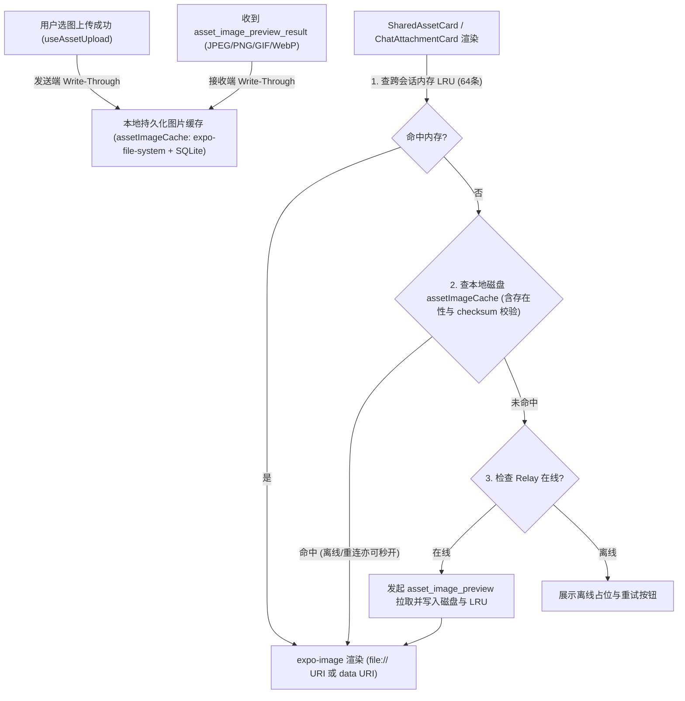

# 移动端生图配置、四格式预览与图片持久化缓存实现方案

> 本文为 **移动端（`mobile/`，Expo SDK 56）独立实施方案**，覆盖：与 Go 后端对齐的 Relay 类型扩展、**「设置 -> 生图模型」** 可视化管理界面、四格式（JPEG / PNG / GIF / WebP）预览解码展示，以及**彻底解决重开/切换会话重复拉取与丢失已发/返回图片的本地持久化缓存架构**。
>
> - 后端生图引擎、配置存储与协议实现见：[Go 后端多模型生图、四格式预览与配置管理方案](FEATURE_BACKEND_IMAGE_GENERATION_PLAN.md)
> - 已单独先行完成并 OTA 发布的交互动画与头像清晰度修复见：[移动端交互动效丢失与画面失真修复方案](FEATURE_MOBILE_ANIMATION_AND_QUALITY_PLAN.md)（其中 `MessageBubble.tsx` 补传 `sessionID` 与 `SharedAssetCard.tsx` 自适应画幅/`cachePolicy="memory"` 已在该次更新先行落地）

---

## 1. 背景与移动端现状诊断

### 1.1 四格式预览与生图模型入口缺口
1. **格式受限**：`mobile/src/utils/assetImagePreview.ts` 的 `decodeAssetImagePreview` 目前硬编码拒绝除 `image/jpeg` 之外的所有类型（且要求 Base64 必须以 `/9j/` 开头、`<= 256 KiB`、`<= 1024px`），`mobile/src/utils/toolAssets.ts` 的 `isRelayPreviewImageAsset` 同样排除了 GIF 和 WebP，且 `isAssistantAssetTool` 尚未识别 `generate_image`。
2. **缺少生图模型配置 UI**：`mobile/src/components/settings/SettingsHome.tsx` 与 `SettingsPanel.tsx` 目前仅提供文本对话模型管理，没有独立「生图模型」设置入口来增删改查多渠道 URL、协议类型与默认模型。

### 1.2 重开/切换会话丢失与重复拉取图片的 5 个精确根因
用户在手机端重开 App、断线重连或切换会话时，已发图片和助手返回图片都会重新向 Agent 请求拉取甚至离线失图，核心根因如下（第 5 点已在动画 OTA 中部分修补 `MessageBubble` 传参）：

1. **内存预览缓存绑定了临时连接且在切换会话时被清理**：`mobile/src/utils/assetImagePreview.ts` 的 `createAssetImagePreviewLoader` 仅用 JS 内存 `Map`（最多 `16` 条、`cacheTTL = 90_000` ms），且主键含会随重连变化的 `connectionID`（`[pairingID, connectionID, sessionID, assetID]`）。`mobile/src/hooks/useAssetImagePreview.ts` 在切换 `sessionID` 或更新 `connectionID` 时调用 `loader.prune()`，直接删掉了非当前会话/连接的缓存项，卸载时更会 `loader.clear()` 全清。
2. **未连接/重连瞬间在查缓存前被离线短路**：`SharedAssetCard.tsx`（`AssetPreview`）在读取缓存前先检查 `if (!props.sessionID || !connection?.connectionID)` 并直接返回 `“中继未连接，连接后可预览”`，阻止了离线或重连期间读取本地缓存。
3. **用户自己发送的图片在历史重载后丢失本地文件关联**：发送消息当刻在内存里保存 `DocumentPicker` 的 `local_uri`，但关闭会话或重新同步后，消息经 `mobile/src/storage/sessionHistoryCache.ts` / 服务端 `session_history` 通过 `mobile/src/utils/chatHistory.ts` 与 `attachments.ts`（`parseAttachedFiles`）从 `<uploaded_file ...>` 恢复，只留存 `asset_id` / `file_name` / `content_type` / `size`，没有对应本地持久化文件记录，导致用户自己发过的图片切回会话后也要从电脑端重新下载。
4. **会话资源目录 `AssetSummary[]` 未持久化**：`mobile/src/hooks/useAssetState.ts` 仅存在于 React 组件内存态，冷启动或离线切换会话时 `catalog` 为空，卡片丢失短链、原始尺寸、`checksum` 等元数据。
5. **图片组件此前禁用缓存 & 工具气泡漏传 `sessionID`**：`SharedAssetCard.tsx` 原设置 `cachePolicy="none"`、`MessageBubble.tsx` 原漏传工具消息卡片的 `sessionID`（这两处编码漏洞已在前一轮动画 OTA 修复，本方案在此基础上补齐磁盘持久化与目录水合闭环）。

---

## 2. 移动端双端写穿与 Cache-First 数据流



---

## 3. 与后端对齐的 Relay 协议定义（`mobile/src/protocol.ts`）

> 所有字段名、枚举值及常量上限必须与 [后端方案第 6 章](FEATURE_BACKEND_IMAGE_GENERATION_PLAN.md#6-前后端共享-relay-websocket-协议契约) 100% 保持一致。

1. **`MessageType` 联合类型增补**：
   - `"image_model_list"` / `"image_model_list_result"`
   - `"image_model_config_add"` / `"image_model_config_add_result"`
   - `"image_model_config_test"` / `"image_model_config_test_result"`
   - `"image_model_config_update"` / `"image_model_config_delete"` / `"image_model_config_enabled_set"` / `"image_model_config_default_set"` / `"image_model_config_mutation_result"`
2. **新增类型定义**：
   ```ts
   export type ImageModelProtocol = "openai-images" | "gemini-native-image" | "google-imagen";
   export type ImageModelAuthType = "bearer" | "x-goog-api-key" | "none";

   export type ImageModelSummary = {
     id: string;
     name?: string;
     provider?: string;
     protocol: ImageModelProtocol;
     auth_type: ImageModelAuthType;
     base_url?: string;
     model_name: string;
     has_api_key: boolean;
     enabled: boolean;
     is_default: boolean;
     supports_reference_images: boolean;
     created_at?: string;
     updated_at?: string;
   };
   ```
3. **`AssetImagePreviewResultPayload`**：
   - `content_type` 放行 `"image/jpeg" | "image/png" | "image/gif" | "image/webp"`。

---

## 4. 四格式预览解码与工具资产识别

### 4.1 资产识别升级（`mobile/src/utils/toolAssets.ts`）
- `isAssistantAssetTool(toolName)`：除 `"attach_image"`、`"share_file"` 外，新增识别 **`"generate_image"`**。
- `isRelayPreviewImageAsset(asset)`：扩展白名单 MIME（`image/jpeg`、`image/png`、`image/gif`、`image/webp`）与文件扩展名（`.jpg` / `.jpeg` / `.png` / `.gif` / `.webp`）。

### 4.2 四格式安全解码（`mobile/src/utils/assetImagePreview.ts`）
- 常量上限对齐后端：`maxPreviewBytes = 2 * 1024 * 1024`（`2 MiB`）、`maxPreviewDimension = 2048`。
- `decodeAssetImagePreview(payload)`：
  - 建立 MIME 与合法 Base64 前缀映射表：
    - `image/jpeg` -> `/9j/`
    - `image/png` -> `iVBORw0KGgo`
    - `image/gif` -> `R0lGOD`
    - `image/webp` -> `UklGR`
  - 校验尺寸 `1..2048` 整数、严格 Base64 字符集与填充长度字节上限 `<= 2 MiB`，返回 `{ uri: "data:<mime>;base64,<data>", width, height, contentType, rawBase64 }`。

### 4.3 卡片透明衬底与格式角标（`mobile/src/components/chat/SharedAssetCard.tsx`）
- `expo-image` 原生直接播放动态 GIF 与动态 WebP：
  - 当图片为透明/动图格式（`image/png`、`image/gif`、`image/webp`）时，在预览容器底部使用柔和中性/微网格背景方便辨识透明区域，并在右上/左上角展示轻量半透明角标（`GIF` / `WebP` / `PNG`）。
  - 继续沿用已落地的动态比例约束与 `cachePolicy="memory"`，全屏放大同样完整播放动图与透明通道。

---

## 5. 移动端图片内容与会话资源持久化缓存

### 5.1 双层持久化存储（新增 `mobile/src/storage/assetImageCache.ts`）

基于已安装的 `expo-file-system`（`Directory`、`File`、`Paths`）与 `expo-sqlite`（复用 `myai_session_history.db` 建表；Web 端降级为带体积限额的 `AsyncStorage` 分键缓存）：

1. **稳定存储主键（完全剥离 `connectionID`）**：
   - 使用 **`(pairing_id, session_id, asset_id)`** 作为唯一主键，不设 90 秒过期。
   - 原生端文件存储目录：`Paths.document` 下的 `myai-asset-images/`，文件名为安全哈希编码 `<pairHash>_<sessionHash>_<safeAssetID>.<ext>`，存储原始二进制图片（`jpg`/`png`/`gif`/`webp`），UI 直接读取 `file:///...` 本地 URI，避免在 JS 堆里反复持有 Base64 大字符串。
2. **SQLite 索引表**：
   ```sql
   CREATE TABLE IF NOT EXISTS session_asset_images (
     pairing_id TEXT NOT NULL,
     session_id TEXT NOT NULL,
     asset_id TEXT NOT NULL,
     file_uri TEXT NOT NULL,
     content_type TEXT NOT NULL,
     width INTEGER NOT NULL DEFAULT 0,
     height INTEGER NOT NULL DEFAULT 0,
     byte_size INTEGER NOT NULL DEFAULT 0,
     checksum TEXT NOT NULL DEFAULT '',
     source TEXT NOT NULL,
     updated_at INTEGER NOT NULL,
     last_accessed_at INTEGER NOT NULL,
     PRIMARY KEY (pairing_id, session_id, asset_id)
   );
   CREATE INDEX IF NOT EXISTS idx_asset_images_lru
     ON session_asset_images(last_accessed_at ASC);
   ```
3. **LRU 容量上限与生命周期级联清理**：
   - 预算上限：`MAX_CACHE_BYTES = 200 * 1024 * 1024`（`200 MiB`）且 `MAX_CACHE_COUNT = 300`。写入超限时按 `last_accessed_at ASC` 淘汰并删除对应磁盘文件。
   - 读取兜底检查：查到记录后核对本地文件存在且大小 `> 0`；若传入远端最新 `checksum` 且与本地不一致，删除旧缓存并触发重新拉取。
   - 级联清理：`session_delete_result` 成功删除会话时调用 `deleteSessionAssetImages(pairingID, sessionID)`；切换/解除配对时支持按 `pairingID` 清理。

### 5.2 发送端 & 接收端双写穿（Write-Through）

1. **发送端写穿（`mobile/src/hooks/useAssetUpload.ts`）**：
   - 用户选择手机本地图片经 `client.upload(...)` 成功返回 `UploadedAssetPayload` 后，若为可预览图片格式且体积 `<= 16 MiB`：
   - 立即将选中文件字节（不依赖系统可能清理的 `DocumentPicker` 临时 cache 路径）拷贝/写入 `assetImageCache.putSentFile(...)`（标记 `source = 'sent'`，记录 `payload.checksum`），并可选预写入预览 loader 的内存 LRU。
   - 之后即便用户切换会话、强杀 App、从历史 `<uploaded_file ...>` 文本重建卡片且 `attachment.local_uri` 为空，也会直接在 `SharedAssetCard` 命中本地已发原图秒开，不再反向从 Agent 下载。
2. **接收端写穿（`mobile/src/utils/assetImagePreview.ts`）**：
   - 收到 `asset_image_preview_result` 解码校验成功后，通过注入的可选 `persistentCache` 把二进制字节异步写入 `assetImageCache.putPreviewBytes(...)`（标记 `source = 'preview'`），并在后续使用轻量 `file:///` URI。

### 5.3 缓存优先加载与测试兼容

1. **改造 `createAssetImagePreviewLoader`（`mobile/src/utils/assetImagePreview.ts`）**：
   - 增加可选注入参数 `persistentCache?: PersistentAssetImageCache` 和可选 `getChecksum?: (sessionID: string, assetID: string) => string | undefined`，**保持无参默认构造与既有 `asset-image-preview.test.cjs` 行为兼容**（或显式传入持久化开关）。
   - 内存缓存调整为跨会话 LRU（默认 `cacheLimit = 64`，key 改为 `[pairingID, sessionID, assetID]`，默认不再因为切会话而被 `prune()` 清空；仅当切换 `pairingID` 或超过 LRU 上限时清理）。
   - **`prune()` 职责收敛**：只终止非当前会话或失效 `connectionID` 上的在途网络请求（`entries` / `pending`），绝不误杀已就绪的内存缓存。
   - **`subscribe(sessionID, assetID, listener)` Cache-First 顺序**：
     1. 查跨会话内存 LRU -> 命中立即同步回调 `ready`；
     2. 若注入了 `persistentCache`，异步查询本地磁盘 `assetImageCache.get(...)` -> 命中且 `checksum` 一致则写入内存 LRU 并回调 `ready`（即使离线/重连也照常完成）；
     3. 仅当本地磁盘未命中时再判断当前是否具备活跃 `connectionID`：在线入队请求 `asset_image_preview`，离线返回 `{ status: "error", reason: "offline" }`。
2. **移除离线短路拦截（`mobile/src/components/chat/SharedAssetCard.tsx`）**：
   - `AssetPreview` 不再在 `!connection?.connectionID` 时提前返回离线错误占位，只要存在 `pairingID` 和 `sessionID`（即 `connection?.loader` 可用）就交由 `RemoteAssetPreview` 订阅 `loader`——本地缓存命中直接出图，只有缓存未命中且确实离线时才渲染“中继未连接”。
3. **接线生命周期（`mobile/src/hooks/useAssetImagePreview.ts`）**：
   - 在 Hook 内注入基于 `assetImageCache` 的 `persistentCache`，将本地持久化实例与 App 全局范围打通。

### 5.4 会话资源目录持久化（`mobile/src/storage/sessionAssetCatalogCache.ts` + `useAssetState.ts`）

- 按 `(pairingID, sessionID)` 缓存当前会话的最新 `AssetSummary[]`（含 `file_name`、`content_type`、`size`、`short_url`、`checksum` 等元数据）。
- 在收到 `asset_list_result`、`assistant_done`、`background_turn_event`（带 `assets`）时持久化落库；
- 在 `useSessionHistorySync.ts` / `MobileAppScreen.tsx` 切换或冷启动加载某会话缓存历史时，同步水合本地目录到 `useAssetState`，保证离线打开会话时资源元数据与图片缩略图同步完整显示。

---

## 6. 手机端「设置 -> 生图模型」管理界面

1. **设置目录入口（`mobile/src/components/settings/SettingsHome.tsx`）**：
   - `SettingsSection` 与 `settingsSectionTitles` 新增 `"imageModel"`（标题：`生图模型`）。
   - 置于「模型」设置行下方，右侧摘要显示当前默认启用的生图模型名（或 `未配置`）。
2. **状态与动作 Hook（新建 `mobile/src/hooks/useImageModelActions.ts`）**：
   - 管理 `imageModels: ImageModelSummary[]`、`defaultImageModelID`、加载/测试/变更反馈状态；封装 `requestImageModelList`、`addImageModel`、`testImageModel`、`updateImageModel`、`deleteImageModel`、`setImageModelEnabled`、`setDefaultImageModel`。
   - 对接 `useRemoteMessageHandler.ts` 处理后端返回的 `image_model_*_result`。
3. **独立 UI 面板（新建 `mobile/src/components/settings/sections/ImageModelSettings.tsx`）**：
   - **模型列表卡片**：展示名称、协议徽标（`OpenAI 图像` / `Gemini 原生` / `Google Imagen`）、是否支持垫图标签、当前默认状态；支持一键设为默认、启用/停用开关、编辑、测试连通性、删除（删除接入 `ConfirmModal`）。
   - **新增/编辑表单**：
     - 协议卡片三选一（支持切换后推荐默认认证头：`openai-images` -> `bearer`；`gemini-native-image` / `google-imagen` -> `x-goog-api-key`）；
     - **全协议均开放 `baseURL` 输入框**（留空时界面下方提示将默认请求官方端点，填入中转 URL 则走自定义渠道）；
     - 认证方式支持 `Bearer 令牌`、`x-goog-api-key`、`无认证`；
     - 编辑模式下 `apiKey` 留空说明“保留原密钥”，但如果用户修改了 `baseURL` 且未填新密钥，前端主动提示需重填新地址对应的密钥；
     - 支持“测试连接”按钮在保存前直接探测可用性与耗时。
   - 在 `mobile/src/components/settings/SettingsPanel.tsx` 挂载该分区。

---

## 7. 移动端涉及文件清单与分阶段实施计划

| 阶段 | 目标与范围 | 核心涉及文件（`[新增]` / `[修改]`） |
| :--- | :--- | :--- |
| **Phase M1**<br/>四格式预览与协议类型扩展 | 扩展 `protocol.ts` 协议类型，解锁 PNG / GIF / WebP 预览解码、识别 `generate_image` 及卡片角标/透明衬底 | `[修改]` `mobile/src/protocol.ts`、`mobile/src/utils/toolAssets.ts`、`mobile/src/utils/assetImagePreview.ts`、`mobile/src/components/chat/SharedAssetCard.tsx` |
| **Phase M2**<br/>图片内容与资源目录持久化缓存 | 落盘图片文件 + SQLite 索引、发送/接收双写穿、移除离线短路、目录缓存水合与删会话清理 | `[新增]` `mobile/src/storage/assetImageCache.ts`、`mobile/src/storage/sessionAssetCatalogCache.ts`<br/>`[修改]` `mobile/src/utils/assetImagePreview.ts`、`mobile/src/hooks/useAssetImagePreview.ts`、`mobile/src/hooks/useAssetUpload.ts`、`mobile/src/hooks/useAssetState.ts`、`mobile/src/hooks/useSessionHistorySync.ts`、`mobile/src/hooks/useRemoteMessageHandler.ts`、`mobile/src/components/chat/SharedAssetCard.tsx`、`mobile/src/screens/MobileAppScreen.tsx` |
| **Phase M3**<br/>「设置 -> 生图模型」UI 与测试补齐 | 完整多渠道生图模型管理界面与协议测试、更新并新增单元测试 | `[新增]` `mobile/src/hooks/useImageModelActions.ts`、`mobile/src/components/settings/sections/ImageModelSettings.tsx`、`mobile/scripts/asset-image-cache.test.cjs`<br/>`[修改]` `mobile/src/components/settings/SettingsHome.tsx`、`mobile/src/components/settings/SettingsPanel.tsx`、`mobile/src/hooks/useRemoteMessageHandler.ts`、`mobile/src/screens/MobileAppScreen.tsx`、`mobile/scripts/asset-image-preview.test.cjs` |

---

## 8. 移动端测试与验收标准

1. **静态类型校验**：`cd mobile && npx tsc --noEmit` 必须 0 报错退出。
2. **现有及扩展单元测试**：
   - `node mobile/scripts/asset-image-preview.test.cjs`：覆盖 JPEG/PNG/GIF/WebP 四格式 Base64 校验、`generate_image` 工具资产解析、跨会话内存 LRU 保留及注入持久化存储后的 Cache-First 回退顺序。
   - `node mobile/scripts/asset-image-cache.test.cjs`（新增）：覆盖 `(pairingID, sessionID, assetID)` 作用域隔离、发送端与接收端双写穿、`200 MiB` / `300` 张 LRU 淘汰同步删除磁盘文件、坏文件自愈回源，以及删除会话清理。
   - `node mobile/scripts/asset-upload.test.cjs` 与 `node mobile/scripts/chat-math-drawing.test.cjs` 继续全部通过。
3. **真机集成验收场景**：
   - **生图配置面板**：分别新增 `openai-images`（自定义中转 URL）和 `gemini-native-image`（官方或中转 URL）生图模型，点击测试连通通过并切换默认项；修改 `base_url` 时校验安全提示拦截空密钥。
   - **四格式显示**：展示工作区或生成的透明 PNG（保留透明质感与格式角标）及动态 GIF/WebP（缩略图与全屏弹窗均正常循环播放）。
   - **离线/重开缓存回归验证**：在会话 A 发送 1 张相册图片并接收 1 张助手返回图片；切到会话 B 再彻底强杀冷启动 App；**断开网络或中继**重进会话 A，用户历史发出图片与助手历史返回图片均应**毫秒级直接展示**，不触发重复 `asset_image_preview` 请求也不闪“中继未连接”；删除会话 A 后本地磁盘对应缓存同步清空。
