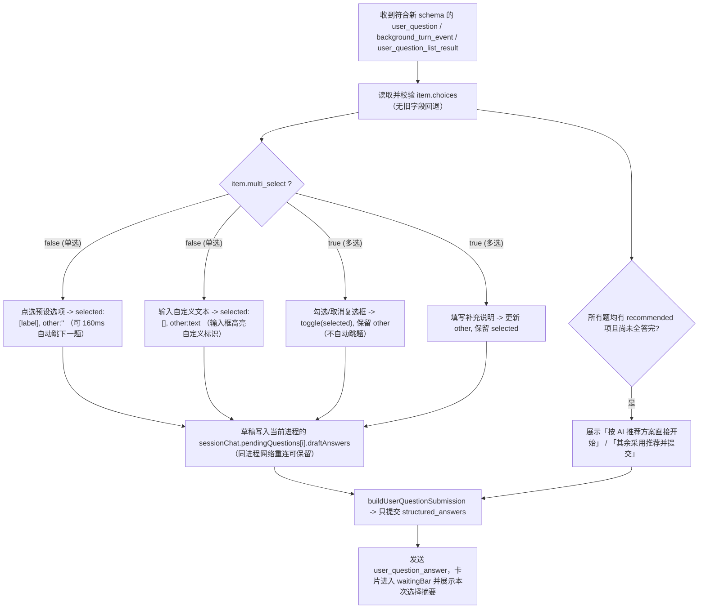

# 移动端主动澄清卡片与推荐 / 多选 / 自定义交互实现方案

> 本文为 **移动端（`mobile/`，Expo SDK 56）独立实施方案**，与后端方案 [Go 后端主动澄清询问（Proactive `ask_user`）与结构化推荐方案](FEATURE_BACKEND_PROACTIVE_ASK_USER_PLAN.md) 保持 1:1 协议对齐，重点实现：
> 1. **AI 自主建议呈现**：选项卡片内展示「推荐」徽标、视觉区分框线与简短推荐理由 `description`；
> 2. **单选互斥 + 多选共存交互**：单选下点选选项与自定义输入智能切换；多选（`multi_select`）下复选框与自定义补充输入框**同时生效叠加**；
> 3. **一键采纳推荐**：提供「按 AI 推荐方案直接开始 / 其余采用推荐并提交」快捷动作与已提交摘要回显。

---

## 1. 背景与移动端现状诊断

当前移动端已经实现了基础版问答卡片 `UserQuestionPrompt` 以及 `user_question` / `user_question_answer` / `user_question_resolved` / `user_question_list_result` 的 Relay 同步通路，但在体验与结构化表达上存在以下 **6 个具体缺口**：

| 模块 | 现状与代码定位 | 具体缺口 |
| :--- | :--- | :--- |
| **协议类型定义** | `mobile/src/protocol.ts`（`UserQuestionItemPayload` / `UserQuestionAnswerPayload`） | 当前选项仅为 `options?: string[]`，缺少结构化 `choices`（`label`、`description`、`recommended`）与 `multi_select`；上行仅支持字符串 `answers`，无法表达多选、自定义补充和推荐采纳。 |
| **状态与草稿模型** | `mobile/src/types/app.ts`（`UserQuestionState`） | `draftAnswers` 为 `Record<string, string>`，无法区分“选中的预设标签数组 `selected`”与“自定义文本 `other`”。 |
| **单选与输入串扰** | `mobile/src/components/permissions/UserQuestionPrompt.tsx`（第 133、144、164 行） | 单选按钮与自定义 `TextInput` 共用同一份 `answers[item.id]` 字符串，导致用户点选任意预设选项后，下方自定义输入框可能复用同一字符串状态，导致预设与自定义回答混淆，用户难以清晰区分“选预设”和“自定义”。 |
| **多选与防误跳缺失** | `UserQuestionPrompt.tsx`（第 137、145-148 行） | 仅有 `accessibilityRole="radio"` 单选态，且选择后 `160ms` 自动跳下一题（`setTimeout`），无法支持“勾选多个页面模块 + 补充说明”且不跳题的多选交互。 |
| **推荐层级与快捷采纳缺失** | `UserQuestionPrompt.tsx`（第 94-205 行） | 没有「推荐」标签与理由副标题，也没有「按 AI 推荐方案直接开始」一键按钮，多题场景下即使用户认可全部推荐也要逐题点选再提交。 |
| **已提交回显简陋** | `UserQuestionPrompt.tsx`（第 171-175 行） | 提交后仅显示固定的 `已提交回答，等待助手继续执行…`，未回显用户刚才选择的方案或“已按推荐方案提交”摘要；且 `useChatMessages.ts` 仅传字符串草稿给 `UserQuestionPrompt`。 |

---

## 2. 交互状态机与数据流



---

## 3. 与后端严格一致的单一协议与状态类型

本功能客户端只实现新协议，不提供旧字段解析、字符串回退、纯文本摘要双写或单选降级。Go、Mobile、Relay Web 需同版本发布；不匹配时提示升级/协议错误，禁止静默丢弃多选答案。上下文检查发生在后端 Agent：以只读工具真实检查项目文件，不把整个仓库内容注入提示词；内部证据记录不传到 Mobile，Mobile 只收到最终问题载荷。

### 3.1 `mobile/src/protocol.ts`

```ts
export type UserQuestionOptionPayload = {
  label: string;
  description?: string;
  recommended?: boolean;
};

export type UserQuestionPayload = {
  schema_version: 2;
  question_id: string;
  title?: string;
  questions: UserQuestionItemPayload[];
};

export type UserQuestionItemPayload = {
  id: string;
  prompt: string;
  choices: UserQuestionOptionPayload[];
  multi_select: boolean;
  allow_other: boolean;
};

export type UserQuestionStructuredAnswerPayload = {
  selected?: string[];
  other?: string;
};

export type UserQuestionAnswerPayload = {
  schema_version: 2;
  question_id: string;
  structured_answers: Record<string, UserQuestionStructuredAnswerPayload>;
  adopted_defaults?: boolean;
  cancelled?: boolean;
};
```

Question payload 和 Answer payload 均须带 `schema_version: 2`。`choices`、`multi_select`、`allow_other` 是必需字段；前端对缺失字段或不合法类型显示协议错误并阻止提交。上行只发 `structured_answers`，不再发送摘要版 `answers`。`cancelled: true` 表示跳过本轮澄清；有安全默认时后端按默认继续，否则 Agent 只做不受该决定影响的部分并说明阻塞点。

### 3.2 `mobile/src/types/app.ts`

```ts
export type UserQuestionDraftAnswer = {
  selected: string[];
  other: string;
};

export type UserQuestionAnswerSubmission = {
  structuredAnswers: Record<string, import("../protocol").UserQuestionStructuredAnswerPayload>;
  adoptedDefaults?: boolean;
};

export type UserQuestionState = {
  questionID: string;
  requestID: string;
  sessionID: string;
  title: string;
  questions: import("../protocol").UserQuestionItemPayload[];
  sourceTaskID?: string;
  submitted?: boolean;
  submittedSummary?: string;
  draftAnswers?: Record<string, UserQuestionDraftAnswer>;
};
```

## 4. 纯函数业务层设计（新增 `mobile/src/utils/userQuestion.ts`）

将协议校验、状态转移、推荐合并与本地摘要序列化全部抽离为零 React Native 依赖的纯函数，便于直接用 Node `node:test` 验证；协议不做旧字段 fallback：

| 导出函数 | 输入 | 行为与边界约束 |
| :--- | :--- | :--- |
| `validateQuestionChoices(item)` | `UserQuestionItemPayload` | 直接验证必需的 `choices` 结构、去空和重复 label；不读取旧字段或构造 fallback。单选多推荐标记按后端规则处理并记录诊断。 |
| `isAllowOtherEnabled(item)` | `UserQuestionItemPayload` | 直接返回必需的 `item.allow_other`；不从选项是否为空推断。 |
| `emptyQuestionDraft()` | — | 返回 `{ selected: [], other: "" }`。 |
| `applySingleSelectOption(label)` | `string` | 返回 `{ selected: [label], other: "" }`（清掉自定义文本，避免单选预设与输入框串扰）。 |
| `applySingleSelectOther(text)` | `string` | 返回 `{ selected: [], other: text }`（一旦用户输入自定义文本，立刻取消已选中的单选预设）。 |
| `toggleMultiSelectOption(draft, label)` | `UserQuestionDraftAnswer?`, `string` | 在 `selected` 中增/删 `label`（保持规范选项顺序或追加顺序去重），**完整保留 `draft.other`**。 |
| `updateMultiSelectOther(draft, text)` | `UserQuestionDraftAnswer?`, `string` | 更新 `other: text`，**完整保留 `draft.selected`**。 |
| `isQuestionDraftComplete(item, draft)` | `item`, `UserQuestionDraftAnswer?` | 单选/多选通用：只要 `(draft?.selected?.length ?? 0) > 0 || Boolean(draft?.other?.trim())` 即视为本题已作答。 |
| `getRecommendedLabels(item)` | `UserQuestionItemPayload` | 单选返回 `[首个 recommended.label]`（若无则 `[]`）；多选返回所有 `recommended` 项的 `label` 数组。 |
| `canAdoptRecommended(items, drafts)` | `items`, `drafts` | 还有未答题且这些题均有推荐项时显示快捷按钮。 |
| `mergeWithRecommendedDefaults(items, currentDrafts)` | `items`, `Record<string, UserQuestionDraftAnswer>` | 遍历每道题：若用户在 `currentDrafts[item.id]` 已完成作答，则保留用户的选择；仅对未作答题填充 `{ selected: getRecommendedLabels(item), other: "" }`。同时计算 `adoptedAllDefaults`（当原本全部未作答且全部采用推荐时为 `true`，部分定制也允许提交并将 `adoptedDefaults` 置 `true` 以告知模型用户认可其余推荐）。 |
| `formatQuestionAnswerSummary(item, draft)` | `item`, `UserQuestionDraftAnswer?` | • 仅有 `selected`：`selected.join("、")`<br>• 仅有 `other`：`other.trim()`<br>• 二者共存（多选场景）：`${selected.join("、")}；补充：${other.trim()}` |
| `buildUserQuestionSubmission(items, drafts, opts)` | `items`, `drafts`, `{ adoptedDefaults?: boolean }` | 只生成 `{ structuredAnswers, adoptedDefaults }`；每题按需包含非空 `selected` 与 trim 后非空的 `other`。显示摘要由单独的本地 `formatQuestionAnswerSummary` 生成，不进入上行协议。 |
| `formatSubmittedCardSummary(items, submission)` | `items`, `submission` | 若 `submission.adoptedDefaults` 且原本为全采纳，展示「已按 AI 推荐方案提交」，否则拼出 `Q1: 极简深色科技感 · Q2: 首屏 Hero 等 3 项`（超长截断）。 |

---

## 5. 交互卡片 UI 与动效设计（`mobile/src/components/permissions/UserQuestionPrompt.tsx`）

遵循现有主题系统 `useAppTheme()` 与 `mobile/src/constants/theme.ts` token（不引入硬编码颜色，兼容暗色 / 亮色主题及 4 套 `AccentPreset`）。

### 5.1 布局结构示意图

```text
+-----------------------------------------------------------------------+
| [Avatar] 需要你的确认 · 第 1/3 题                                       |
|          确认官网设计方向与功能板块                                     |
|  [ ✓ 问题 1 ]  [ 问题 2 ]  [ 问题 3 ]                                  |
|-----------------------------------------------------------------------|
| 1. 官网整体采用什么视觉风格？                      (多选时显示 [多选])   |
|                                                                       |
|  +-----------------------------------------------------------------+  |
|  | (●) 极简深色科技感                                    [AI 推荐] |  |
|  |     高对比深色画布 + 玻璃拟态微交互，最贴合 AI 基础设施定位       |  |
|  +-----------------------------------------------------------------+  |
|  +-----------------------------------------------------------------+  |
|  | (○) 清爽浅色编辑风                                               |  |
|  |     大留白、清晰排版层级与柔和描边，突出企业级可信度               |  |
|  +-----------------------------------------------------------------+  |
|                                                                       |
|  自定义回答（与上方单选自动切换 / 多选时为「补充要求（可叠加生效）」）    |
|  +-----------------------------------------------------------------+  |
|  | 或者直接输入你的自定义想法…                                       |  |
|  +-----------------------------------------------------------------+  |
|-----------------------------------------------------------------------|
|  [ ⚡ 按 AI 推荐方案直接开始 ]  (全幅次级高光按钮；已填部分时显示其余采用推荐)|
|  [   暂不回答   ]              [         下一题 (1/3) / 确认提交      ]  |
+-----------------------------------------------------------------------+
```

### 5.2 关键视觉与交互细则

1. **头部与题型标签**：
   - 保留现有 `CharacterAvatar circular size={24} slot="attention" variant="avatar"` 及分页胶囊条 `stepTabs`（`stepTabActive` / `stepTabDone`）。
   - 当 `currentItem.multi_select` 为 `true` 时，在题干旁或题干右上角展示浅品牌色徽标 `多选 · 可叠加补充`（底色 `palette.brandWash`，文字 `palette.brandLight`）。
2. **结构化选项行（Single & Multi）**：
   - 图标区分：单选用 `Feather name={selected ? "check-circle" : "circle"}`，多选用 `Feather name={selected ? "check-square" : "square"}`，图标与标题顶部对齐（`alignItems: "flex-start"`，适配含 `description` 的两行结构）。
   - 推荐徽标：当 `choice.recommended` 为 `true` 时，标题右侧展示紧凑药丸标签 **「推荐」**（背景 `palette.brandWashStrong`、边框 `palette.brandDeep`、文字 `palette.brandLight`）；未选中状态下选项外框使用浅提示边框 `palette.brandDeep`，选中态统一切换为 `palette.brandWash` + `palette.brand` 边框。
   - 理由副标题：存在 `choice.description` 时，在 `label` 下方展示 `12px` / `lineHeight: 17` / `palette.ink3` 说明文本（最多 `numberOfLines={3}`）。
   - **自动切题规则修正**：仅当 `!currentItem.multi_select && total > 1 && safeIndex < total - 1` 时，点击单选项后延迟 `160ms` 自动跳至下一题；多选题与输入自定义文本框**绝不触发自动跳题**。用户在多选完成勾选后点击右下角「下一题」即可。
3. **自定义输入框与状态隔离**：
   - Single-select：输入框的 `value` 仅绑定 `currentDraft.other`（不再读取 `currentDraft.selected`）。用户输入非空内容时立即调用 `applySingleSelectOther(text)` 清空选中预设，输入框边框高亮为 `palette.brandDeep` 并显示小标签 `已使用自定义回答`；反之若用户在输入后又回头点了预设选项，立即执行 `applySingleSelectOption(choice.label)` 切回预设选项。
   - Multi-select：输入框的 `value` 仅绑定 `currentDraft.other`，占位文案为 `补充其他要求或偏好（可与上方选项同时生效）…`，输入内容同时在底部显示轻提示 `已选 X 项 + 附加补充说明`（当二者均有值时）。
   - `questions` `ScrollView` 保持 `keyboardShouldPersistTaps="handled"`，防止点击提交/切题按钮时先收起键盘导致一次点击失效。
4. **一键按推荐方案开始 / 其余采用推荐**：
   - 显示条件：`!question.submitted && canAdoptRecommended(items, drafts)`。
   - 文案动态切换：`answeredCount === 0` 时显示 `按 AI 推荐方案直接开始`；`0 < answeredCount < total` 时显示 `其余采用推荐并提交`。
   - 点击动效与触感：调用 `Haptics.notificationAsync(Success)` 与轻弹簧缩放脉冲（遵循 `reduceMotion` 开关），将 `mergeWithRecommendedDefaults(items, drafts)` 结果立即写入草稿并调用 `onAnswer(submission)`，其中 `submission.adoptedDefaults` 为 `true` 直接提交。
5. **取消与提交动效及已提交态**：
   - 点击「暂不回答」会清理 `autoAdvance` 定时器并提交跳过。卡片在服务端确认前展示提交状态，断线恢复后仍待答时重新启用操作。
   - `question.submitted === true` 后，`waitingBar` 下方展示一行 `question.submittedSummary`（例如 `已按推荐提交：极简深色科技感 · 首屏 Hero 等 3 项 · 现有前端技术栈`），避免用户忘记自己刚才选了什么。
6. **二级页浮层与对话流内联一致性**：
   - `ChatPanel.tsx`（第 390-398 行）与 `MobileMainContent.tsx`（第 339-347 行，用户在文件/设置/知识库等二级页面时的待提问卡片）同时复用同一 `UserQuestionPrompt` 组件，只需对齐新回调签名即可同步生效。

---

## 6. Hooks、状态同步与重连恢复改造

| 文件 | 符号 / 位置 | 改动要点 |
| :--- | :--- | :--- |
| `mobile/src/hooks/useChatActions.ts` | `answerUserQuestion`（第 110-129 行） | 参数改为 `(question, submission: UserQuestionAnswerSubmission, cancelled = false)`；发送 `user_question_answer` 时只传 `{ question_id, structured_answers, adopted_defaults, cancelled }`；本地单独记录 `submittedSummary`。若发送失败且非取消，保留结构化草稿供重试。 |
| `mobile/src/hooks/useChatMessages.ts` | `setSessionQuestionDraft`（第 396-403 行）、`setSessionPendingQuestion`（第 381-394 行） | `setSessionQuestionDraft` 改为接收 `Record<string, UserQuestionDraftAnswer>`；同一 App 进程内通过 `user_question_list_result` 重连同步同一 `questionID` 时保留既有 `draftAnswers` 与 `submittedSummary`。草稿只在客户端内存中，进程终止/重启恢复不在本方案范围内。 |
| `mobile/src/hooks/useRemoteMessageHandler.ts` | `rememberQuestion`（第 421-435 行）、`user_question_list_result`（第 837-858 行） | 严格校验服务端必需的新协议字段；重连发现服务端确认答案未接收的提问仍处于 pending 时恢复 `submitted: false` 并保留用户已勾选的 `draftAnswers`。遇到缺字段/旧 schema 时呈现协议升级错误，不降级渲染。 |
| `mobile/src/screens/mobileContentProps.ts` | `ChatContentProps` / `PermissionContentProps` | 对齐 `onAnswerUserQuestion` 与 `onChangeUserQuestionDraft` 的强类型定义。 |
| `mobile/src/components/chat/ChatPanel.tsx` & `mobile/src/screens/MobileMainContent.tsx` | `UserQuestionPrompt` 渲染点 | 透传更新后的回调；确认对话流中插入新提问卡片或切换题目时滚动容器不被遮挡。 |
| `mobile/src/screens/MobileAppScreen.tsx` | 第 1218、1560-1561、1650-1651 行 | 对接 `answerUserQuestion` 与 `setSessionQuestionDraft`；已验证 `agentActivity` 已在 `pendingQuestions.length > 0` 时切换至 `"permission"`（对应吉祥物 `attention` 状态）。 |

> **历史持久化一致性说明**：当问答提交成功后，后端工具将结果写回模型上下文并继续执行生成最终回复，而历史消息中的工具调用轨迹来自服务端 `session_history`；`pendingQuestions` 仅维护活跃等待态卡片，由 `user_question_resolved` 与 `user_question_list_result` 精确清理，无需额外改动历史消息存储表结构。未提交的草稿仅存于当前进程内存，不能由服务端重连快照重建。

---

## 7. 移动端分步实施清单与测试验收计划

### 7.1 改动文件总览

| 序号 | 文件路径 | 动作 | 核心变更 |
| :--- | :--- | :--- | :--- |
| 1 | `mobile/src/protocol.ts` | 修改 | 新增 `UserQuestionOptionPayload`、`UserQuestionStructuredAnswerPayload`；扩展 `UserQuestionItemPayload`、`UserQuestionAnswerPayload`。 |
| 2 | `mobile/src/types/app.ts` | 修改 | 新增 `UserQuestionDraftAnswer`、`UserQuestionAnswerSubmission`；更新 `UserQuestionState`。 |
| 3 | `mobile/src/utils/userQuestion.ts` | 新建 | 实现新协议结构校验、单/多选草稿状态转移、推荐采纳合并、摘要格式化与载荷构建纯函数。 |
| 4 | `mobile/src/components/permissions/UserQuestionPrompt.tsx` | 修改 | 实现「推荐」徽标、理由副标题、单/多选控件、隔离式自定义输入与并存提示、「按 AI 推荐方案直接开始 / 其余采用推荐」一键按钮及提交摘要回显。 |
| 5 | `mobile/src/hooks/useChatActions.ts` | 修改 | 升级 `answerUserQuestion` 发送 `structured_answers` 与 `adopted_defaults`。 |
| 6 | `mobile/src/hooks/useChatMessages.ts` | 修改 | 升级草稿类型与断线重连 `draftAnswers` 保留。 |
| 7 | `mobile/src/screens/mobileContentProps.ts`、`MobileAppScreen.tsx`、`MobileMainContent.tsx`、`ChatPanel.tsx` | 修改 | 透传更新后的提问回答与草稿回调签名。 |
| 8 | `mobile/scripts/user-question.test.cjs` | 新建 | 按现有 `node:test` + TypeScript 运行方式编写完整纯函数及组件渲染单元测试。 |

### 7.2 单元测试与端到端手测清单

1. **自动化单元测试（新增 `mobile/scripts/user-question.test.cjs`）**：
   - `validateQuestionChoices`：覆盖新协议必需字段、空/重复 label、非法结构拒绝与单选多 `recommended` 的确定性处理；
   - `isAllowOtherEnabled`：验证必需 `allow_other` 精确控制输入框展示，不从 choices 数量推断；
   - 单选交互：`applySingleSelectOption` 会清空 `other`，`applySingleSelectOther` 会清空 `selected`；
   - 多选共存：`toggleMultiSelectOption` 与 `updateMultiSelectOther` 相互独立不覆盖，摘要生成 `selected + ；补充：other`；
   - 一键推荐：`canAdoptRecommended` 严格判定；全未填一键采纳返回 `adoptedDefaults: true`；用户已自定义第 1 题、点「其余采用推荐并提交」时不覆盖第 1 题；
   - 协议构建：`buildUserQuestionSubmission` 只生成合法 `structured_answers`；验证 `useChatActions` 发送的结构化载荷、推荐采纳标记与本地摘要一致，缺失或非法字段会被拒绝而不回退旧协议。
   - 协议升级验收：Go 后端、Mobile、Relay Web 使用 schema v2 一起部署；缺失/错误 schema_version 必须展示升级错误，不能按旧字段猜测或静默丢弃。
2. **静态与脚本回归命令**：
   ```powershell
   cd mobile
   npx tsc --noEmit
   node scripts/user-question.test.cjs
   node scripts/asset-image-preview.test.cjs
   node scripts/asset-upload.test.cjs
   node scripts/chat-math-drawing.test.cjs
   ```
3. **真机端到端手测场景**：
   - **场景 1（高影响偏好确实未知时主动提问）**：在无既有代码、品牌规范或技术约束的新项目中发送 `"实现一个 AI 创业公司官网"`，并确认视觉方向/范围选择会显著影响返工 -> 验证手机端弹出带推荐理由的问答卡片、吉祥物切到 `attention`；另测在已有明确项目约束时 Agent 先通过相关只读工具实际检查文件，再不重复询问可从工作区查明的信息；如果声称检查过但本 turn 没有对应成功工具事件，后端门禁应拒绝该提问。并验证低影响可逆选择采用默认、用户明确说“你自行决定”时跳过提问。
   - **场景 2（单选自定义切换）**：第 1 题点一个预设项后再点自定义框输入，确认预设选中高亮自动取消且未把预设文字带入输入框；
   - **场景 3（多选 + 补充共存）**：第 2 题勾选 2 个板块，不自动跳下一题；在底部输入框补充一句“需要暗黑模式切换开关”，点「下一题」，提交后确认助手回复同时包含这 2 个板块和暗黑开关；
   - **场景 4（一键按推荐开始）**：重发一个宽泛需求，不逐题选择直接点「按 AI 推荐方案直接开始」，确认立即提交且回显推荐摘要；部分定制后点「其余采用推荐并提交」，确认自定义题未被推荐覆盖；
   - **场景 5（同进程断线重连草稿保护）**：保持 App 进程存活，答完第 1 题后切后台断网再恢复连接，验证 `user_question_list_result` 恢复卡片后第 1 题草稿完整保留。此验收不覆盖系统杀进程或重启 App；服务端只恢复未完成的问题，不保存尚未提交的本地草稿。若后续要求冷启动恢复，另行增加本地持久化、过期与清理策略。
